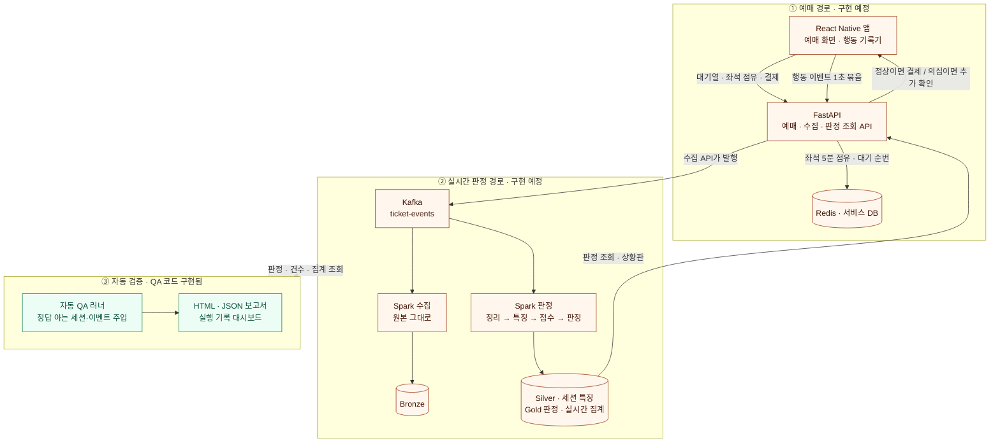
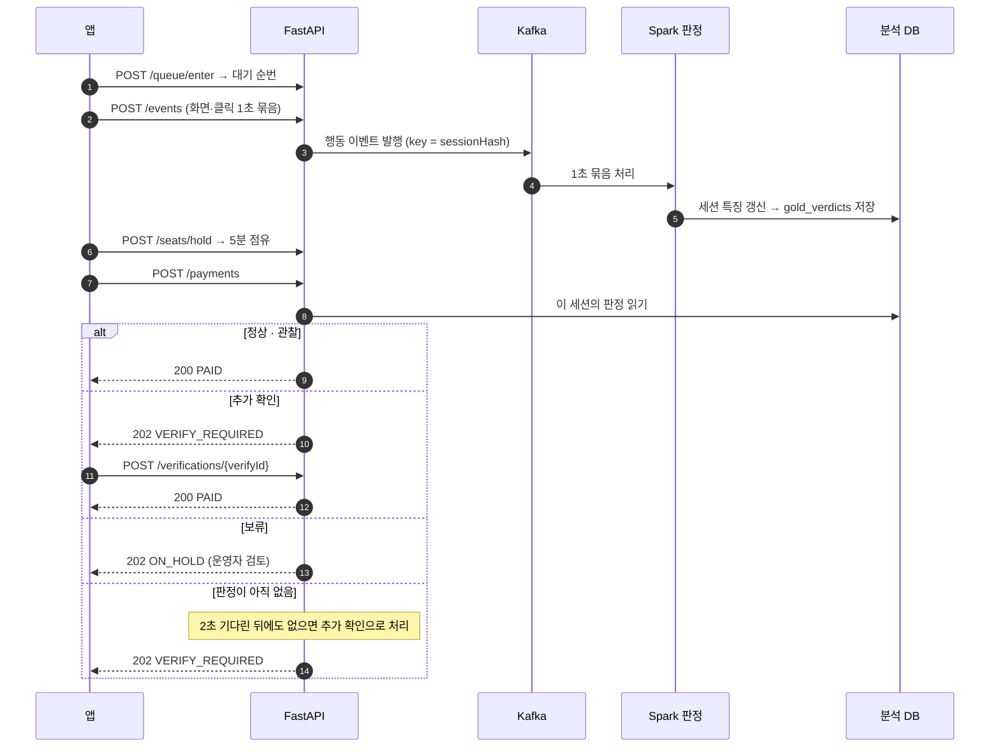
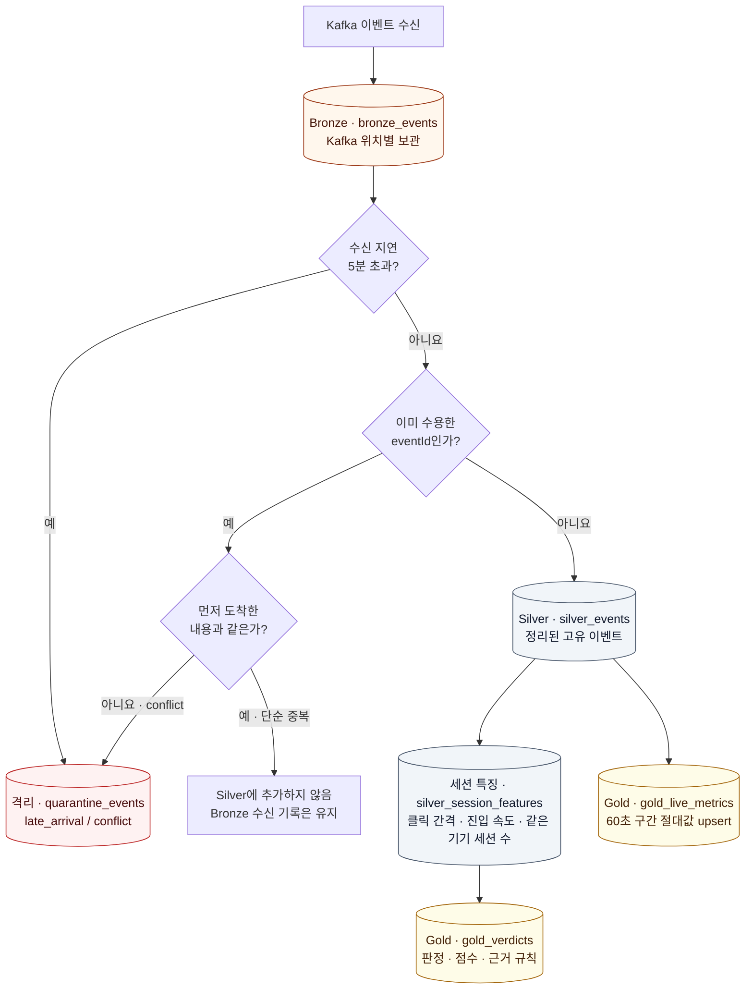
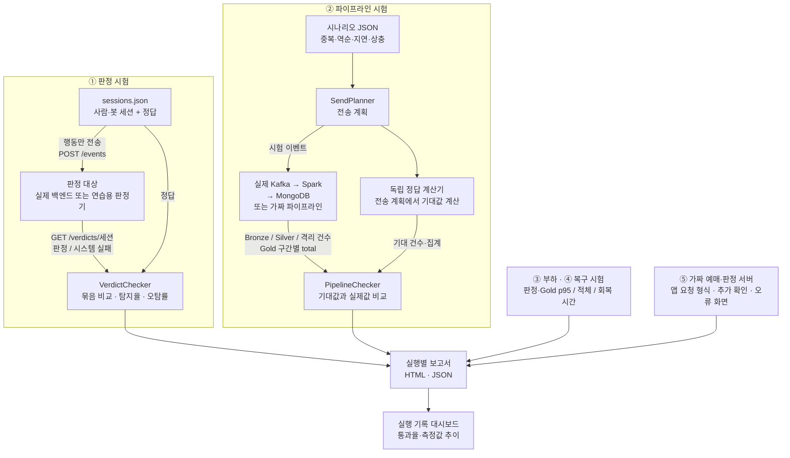
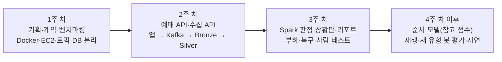
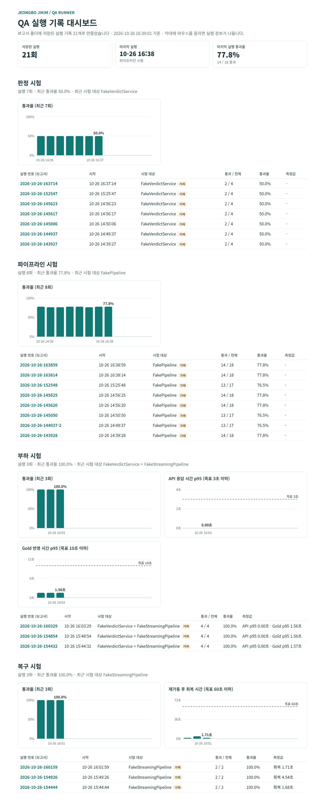

# 티켓가드

[](https://github.com/seoloo/MLO2_3rd_Project/actions/workflows/qa.yml)

**실시간 매크로 탐지 예매 시스템.** 예매 앱을 직접 만들고, 예매하는 동안 생기는 클릭 기록을 Kafka → Spark → MongoDB로 실시간 분석해 사람과 매크로(봇)를 몇 초 안에 구분합니다. 의심 세션에만 결제 직전 본인 확인을 한 번 더 걸고, 운영자 상황판과 기획사 판매 리포트로 결과를 보여 줍니다. 프로젝트의 핵심 성과는 **판정과 데이터 처리가 정확하고 장애가 나도 복구된다는 것을 자동 QA로 증명**하는 데 있습니다.

> **현재 구현 상태 (2026.11.02):** 2026.11.02에 주제를 정보지킴(스미싱 판정)에서 티켓가드로 바꿨습니다. 연결 계약·QA 러너·보고서·데스크탑 앱·CI는 티켓가드 형식으로 바뀌어 있고, 실제 백엔드·Kafka·MongoDB·Spark에 연결하는 QA 코드도 준비되어 있지만 통합 검증은 대기 중입니다. 앱·백엔드·인프라는 설계 단계로, 아래 서비스 도식은 **목표 구조**입니다.

**바로 보기:** [QA 설치·사용 안내](qa/docs/install-and-use.md) · [매크로 봇 작업 계획](qa/README.md#macro-bot-plan) · [연결 계약](docs/contract.md) · [QA 데스크톱 앱](#qa-desktop-ui) · [전체 구조](#전체-흐름) · [예매 1건의 흐름](#예매-1건의-요청이벤트판정-순서) · [데이터 처리](#data-processing) · [QA 검증](#qa-flow) · [진행 상황](#진행-상황) · [실행 방법](#시작하기)

## 무엇을 만드나

| 영역 | 내용 |
|---|---|
| 문제 | 인기 공연은 몇 분 안에 매진되고, 매크로가 먼저 좌석을 가져가 웃돈 거래로 이어짐 |
| 해결 | 직접 만든 예매 앱의 행동 기록을 실시간 분석해 세션마다 판정 · 의심 세션만 결제 전 추가 확인 |
| 판정 | `정상` / `관찰` / `추가 확인` / `보류` 네 단계. 자동 차단은 하지 않고 운영자가 최종 결정 |
| 대상 | 예매 플랫폼 운영자(실시간 상황판) · 공연 기획사(판매 결과 리포트). 리셀 중개 플랫폼은 확장 대상 |
| 근거 | 공연법 제4조의2 ② 입장권 판매자의 부정구매 방지 조치 의무 (2026-10-29 시행, 기획서 기준 · 시행령 세부는 확인 예정) |
| 데이터 | 외부 API 없음. 우리 앱에서 가상 사람 · 봇 5종 · 동의한 실제 사람이 만든 기록이라 사람인지 봇인지 정답을 앎 |
| 데이터 파이프라인 | Kafka → Spark 구조적 스트리밍 → MongoDB 메달리온 (Bronze → Silver → Gold) |
| 자동 QA | 정답을 아는 세션과 이벤트를 넣고, 시스템 결과와 비교해 채점·보고서 작성 |

**왜 실시간인가:** 판정이 결제 전에 나와야 추가 확인을 걸 수 있습니다. 좌석은 5분만 잡아 두므로 하루 한 번 배치는 매진 뒤 결과가 되고, 스트림이 멈추면 추가 확인도 멈춥니다. 그래서 [연결 계약](docs/contract.md#3-예매-api-b--a)은 "결제 때 판정이 없으면 2초 기다린 뒤 추가 확인"을 초안으로 둡니다.

<a id="qa-desktop-ui"></a>

## 자동 QA 데스크톱 UI

> **처음 쓰는 팀원이라면 [QA 설치·사용 안내](qa/docs/install-and-use.md)부터 보세요.** 설치 방법 고르기, 첫 시험, 결과 읽는 법, 내 API 시험하기, 문제 해결까지 순서대로 정리했어요.

첫 화면에서 확인하고 싶은 내용을 고르면 필요한 시험을 안내합니다. 실행 조건을 확인한 뒤 직접 시작하며, 완료 후에는 예상 정답·기준과 실제 값을 비교하고 다음 확인 사항을 볼 수 있습니다. 이전 실행은 이 PC에 저장한 보고서에서 읽습니다.

[WPF UI](https://github.com/lepoco/wpfui) 4.3.0의 밝은 컨트롤에 민트 프레시 색(청록 + 초록)을 입혔습니다. 왼쪽 메뉴는 홈·시험·기록·관리이고, 홈에서 여정 지도와 ‘다음 할 일’을 따라가면 첫 점검을 끝낼 수 있습니다. 시험은 서비스 · 앱 · QA 도구 영역 카드로 나뉩니다. 서비스 영역은 판정·데이터 처리·부하·복구 시험, 앱 영역은 백엔드 없이 A의 앱을 붙이는 **가짜 예매·판정 서버**, QA 도구 영역은 QA 프로그램 자체 점검입니다. 시험이 끝나면 완료 카드와 상태 표시줄 색 띠로 알려 줍니다. 홈 배너 배경은 선택한 20개 이미지 중 앱을 켤 때마다 한 장을 무작위로 표시합니다. 소스의 저작권·라이선스와 배경 출처는 `qa/src/QaRunner.Desktop/THIRD-PARTY-NOTICES.txt`에 기록했습니다.

처음 사용하는 경우 제목 표시줄의 **사용 안내** 또는 **F1**을 누르세요. 버튼·입력칸에 마우스를 잠시 올리면 기능과 입력 예시가 표시됩니다.

공통 탐색, QA 실행, 결과 비교, 시험 세션·검수 근거 조회, 로컬 공유와 보고서 이력을 구현했습니다. Runpod(새 유형 봇 시나리오 생성)·EC2 공유, 라벨 수정·승인, 세부 진행률·취소·설정 영구 저장은 후속 구현입니다.

디자인 검토용 PNG·PDF·HTML·압축 파일과 화면 캡처는 저장소에 보관하지 않습니다.

팀원에게 전달할 Windows 64비트 배포본은 `qa/publish-qa-desktop.cmd`로 만듭니다. 배경 20개를 포함해 실행 파일은 약 **27.6 MiB**, 전달용 ZIP은 약 **12.7 MiB**입니다. 실행 PC에는 .NET 10 Desktop Runtime(x64)이 필요합니다. Kafka·MongoDB 라이브러리와 Spark·Runpod·EC2 확장 구조는 유지하며, 배포 대상과 다른 운영체제의 바이너리만 해당 배포본에서 제외합니다. 자세한 내용은 [QA 배포 안내](qa/README.md#배포-파일로-실행하기)에 있습니다.

## 전체 흐름

예매를 처리하는 경로와 행동 이벤트를 분석하는 경로를 나눕니다. **노란색은 구현 예정인 서비스**, **초록색은 구현된 QA 코드**입니다. 점선은 QA가 판정과 처리 결과를 조회하는 연결입니다.



- 이벤트에는 이름·전화번호·정답 정보(사람인지 봇인지)를 넣지 않고, 사용자와 기기는 해시로만 다룹니다.
- 기기가 보낸 이벤트(`origin: client`)는 봇이 꾸밀 수 있어서, 예매 API가 직접 만든 이벤트(`origin: server`)와 구분합니다. 화면 기록 없이 API만 부른 세션도 판정 신호입니다.
- 예매를 처리하는 서비스 DB와 분석하는 분석 DB를 나눠 분석 부하가 예매 처리를 느리게 하지 않게 합니다.

### 예매 1건의 요청·이벤트·판정 순서

연결 계약 초안 기준입니다. 판정은 결제 전에 나와야 하고, 늦으면 결제가 그냥 통과하지 않습니다.



## 기획 요약

2026.11.02 티켓가드 기획서(28쪽)의 내용을 GitHub에서 바로 볼 수 있게 옮겨 둔 것입니다. 원본 PDF는 내부 문서라 저장소에 올리지 않습니다.

> **매진 뒤가 아니라 결제 전에 · 모두가 아니라 의심 세션에만 · 비공개가 아니라 근거와 숫자로.** (React Native · FastAPI · Kafka · Spark · MongoDB · AWS · RunPod · 3명 + QA 트랙 · 4주 + 이후 확장)

### 기존 대응 속 자리

매크로 대응을 네 계층으로 나누면 티켓가드는 **③ 구매 중** 계층입니다. 기존 시스템을 바꾸자는 것이 아니라, 방식이 비공개라 다른 판매자가 가져다 쓸 수 없는 빈 계층을 채웁니다.

| 계층 | 하는 일 | 놓치는 것 |
|---|---|---|
| ① 입장 전 | 본인인증 · 사전 등록 · 계정 심사 | 인증된 계정이 자동 프로그램으로 사는 것 |
| ② 접속 관문 | 보안문자 · 대기열 관문 | 사람처럼 접속한 봇 (보안문자를 자동 입력하는 사례도 보도됨) |
| **③ 구매 중 (티켓가드)** | 대기열 → 좌석 → 결제 흐름의 행동으로 세션 판정 | — |
| ④ 구매 후 | 모니터링 · 강제 취소 · 신고 | 이미 끝난 매진 |

| 주장하는 것 | 주장하지 않는 것 |
|---|---|
| ①·②·④와 함께 쓰는 ③ 구매 중 계층 | 기존 시스템 대체, 대형사보다 "더 잘 잡는다"는 성능 우위 |
| 판정마다 규칙 번호 · 측정값 · 기준 버전을 남기는 설명 가능한 구조 | 실제 예매 사이트에서의 효과 |
| 정답 있는 데이터와 자동 QA로 다시 재 볼 수 있는 검증 | 사람을 "매크로 사용자"로 단정하는 표현 |

### 데이터: 외부 데이터 없이 우리 앱에서 정답까지

데이터를 만드는 쪽(QA 트랙)과 판정하는 쪽(백엔드)을 나눕니다. 판정 코드는 정답 표를 읽을 수 없습니다.

| 유형 | 행동 규칙 (공개) | 쓰임 |
|---|---|---|
| 가상 사람 (Locust) | 단계별 머무는 시간·클릭 간격을 사람 분포에서 뽑음 · 망설임 · 되돌아가기 | 학습 · 평가 |
| 봇 A · B (Locust) | 오픈 즉시 진입 · 같은 간격(A) / 간격에 작은 무작위(B) | 학습 · 평가 |
| 봇 C (Playwright) | Expo 웹 화면을 실제로 누름 · 사람과 가장 비슷한 흔적 | 학습 · 평가 |
| 봇 D (Locust) | 한 기기에서 세션 수십 개로 대기열에 동시 진입 | 학습 · 평가 |
| 새 유형 봇 | 학습에 쓰지 않은 규칙 · 다른 사람이 따로 작성 | 평가만 |
| 실제 사람 | 동의를 받은 참여자가 직접 예매 · 회차 반복 | 분포 기준 · 평가 |

- 봇·부하 도구는 **우리 앱에만** 사용하고, 실제 예매 사이트에는 자동으로 접속하지 않습니다. 가상 공연·모의 결제만 씁니다.
- 사람 테스트는 동의서·수집 항목 최소화·기기 정보 해시·시험 종료 후 원본 삭제로 진행합니다.
- 벤치마킹(티켓링크)은 사람이 직접 써 보며 기록만 하고, 화면을 복제하지 않습니다.

<a id="data-processing"></a>

### 메달리온: Kafka → Bronze → Silver → Gold

아래는 Spark 작업에서 구현할 처리 규칙입니다. **Kafka 위치는 수신 기록의 고유 키**, **eventId는 중복 제거의 기준**, **occurredAt은 집계 구간의 기준**입니다.



예를 들어 **같은 좌석 클릭 이벤트를 앱이 3번 재전송**하면 서로 다른 Kafka 위치의 Bronze 기록은 **3건**, Silver는 **1건**, 해당 Gold 구간에 더해질 이벤트 수는 **1건**입니다. 5분 초과 도착·같은 ID 상충은 Bronze에 수신 흔적을 남기고 격리합니다.

| 계층 | 컬렉션 | 하는 일 | 고유 기준 |
|---|---|---|---|
| Bronze | `bronze_events` | 받은 이벤트 원본 보관. 7일 뒤 S3 일별 파일로 옮겨 재생 시험·학습에 사용 | topic + partition + offset |
| Silver | `silver_events`, `silver_session_features` | eventId 중복 제거·발생 시각 순 정리 · 세션별 특징 계산 | eventId / sessionHash |
| Gold | `gold_verdicts`, `gold_live_metrics`, `gold_reports` | 세션 판정 · 60초 구간 실시간 집계 · 회차별 리포트(배치) | sessionHash / 구간 / showId |

<a id="qa-flow"></a>

### 자동 QA: 정답을 아는 입력 + 독립 정답 비교

QA는 정답을 아는 세션으로 판정을 확인하는 경로와, 이벤트를 Kafka에 직접 넣어 데이터 처리를 확인하는 경로를 따로 제공합니다. **정답은 API에 보내지 않고**, 파이프라인 정답은 QA가 전송 계획에서 독립 계산합니다. 시스템은 Python, QA는 C#이라 정답 계산이 시스템 코드와 자연스럽게 분리됩니다.



- **대상 교체:** 연결 옵션이 없으면 연습용 대상, `--api-url`을 주면 실제 백엔드, `--kafka`·`--mongo`를 주면 실제 파이프라인을 사용합니다. 채점기·보고서는 공통입니다.
- **판정 채점은 묶음으로:** 사람은 `정상·관찰`, 봇은 `추가 확인·보류`이면 통과입니다. 사례별 결과 뒤에 봇 탐지율과 사람 오탐률을 덧붙이고, 사람 세션이 적으면 참고값이라고 표시합니다.
- **CI 해석:** 연습용 대상은 일부 결함을 의도적으로 내므로, 단위 시험과 QA 도구 점검은 모두 통과해야 하지만 시연 시험의 종료 코드 `1`(채점 실패)은 허용하고 `2`(준비 오류)는 실패로 처리합니다. 초록 배지가 실제 서비스의 정확성이나 성능 달성을 뜻하지는 않습니다.

| 구분 | 항목 | 기준 |
|---|---|---|
| 정확성 | Bronze · Silver · 격리 · Gold 건수 | QA 정답 계산값과 같음 (중복 3회여도 1건, 5분 넘게 늦으면 격리) |
| 부하 | 판정까지 걸린 시간 p95 / 오류율 / Gold 반영 시간 p95 | 3초 이하 / 0% / 10초 이하 (동시 사용자 5명 · 300초, 오픈 몰림은 Locust로 추가 측정) |
| 복구 | 재가동 후 회복 시간 | Spark 30초 중단 · 120초 시험에서 60초 이하, 최종 집계 일치 |
| 탐지 (초기 목표) | 봇 A·B·D / 봇 C 탐지율 · 사람 오탐률 | 90% 이상 / 70% 이상 · 1% 이하. 새 유형 봇은 목표 없이 결과 공개 |

표의 수치는 실측 전 목표입니다. 학습 회차와 평가 회차를 나누고, 정답 표는 QA 영역에만 두며, 미달해도 조건·원인과 함께 기록합니다.

### 역할: 데이터 길은 인프라, 판단 로직은 백엔드, 보이는 것은 앱, 증명은 QA

| 담당 | 맡는 일 | 주요 산출물 |
|---|---|---|
| A · 앱 | 사용자가 보고 누르는 모든 화면과 행동 기록 | 예매 화면 · 행동 기록기 · 운영자 상황판 · 기획사 리포트 · Expo 웹 |
| B · 백엔드 | 예매 처리와 실시간 판정 로직 | 예매·수집·판정 API · Spark 판정 작업 · 규칙 점수 · 순서 모델 |
| C · 인프라 | 데이터가 흐르고 쌓이고 보관·재생되는 길 | Docker · EC2 · Kafka 토픽 · Bronze 수집 · DB 분리 · S3 재생 도구 · 배치 집계 · RunPod 환경 |
| QA 트랙 | 입력과 정답을 따로 만들고 시스템이 맞게 도는지 증명 | 트래픽 생성기 · 사람 테스트 · 시험 사례 · 주간 보고서 · 탐지 평가 |

### 4주 일정: 1주 설계·환경 → 2주 수집 → 3주 판정·시험 → 4주 이후 모델·평가



| 주차 | 끝났을 때 되어 있어야 하는 것 | 확인 방법 |
|---|---|---|
| 1주 | 연결 계약 확정 · 공용 서버에서 전체 서비스 실행 | QA 도구 점검 통과 · 서비스 기동 확인 |
| 2주 | 앱 → Kafka → Bronze → Silver까지 이벤트가 흐름 | 파이프라인 시험 (중복 · 역순 · 지연) |
| 3주 | 판정 · 추가 확인 · 상황판 동작 · 리포트 생성 | 판정 · 부하 · 복구 시험 · 사람 테스트 |
| 4주 이후 | 순서 모델 · 새 유형 봇 평가 · 시연 | 재생 시험 · 탐지 평가 보고서 |

### 지연되면 범위를 줄이고 연결·검증은 유지

- **먼저 줄일 것:** 순서 모델은 4주 이후 참고 점수, 기획사 리포트는 단순 표, 봇 C·Expo 웹은 시간이 남으면, S3 재생은 Kafka 보관분 재생으로 대신
- **지킬 것:** 예매 흐름(대기열 → 좌석 → 결제 → 추가 확인), 행동 기록 → Kafka → Spark 판정 → Gold, 판정 조회 API, 운영자 상황판, 정확성·복구 시험
- 미달 수치는 조건·원인과 함께 공개합니다.

### 1주차 계약에서 확정할 것

아래 항목은 [연결 계약 초안(docs/contract.md)](docs/contract.md)에 초안 값과 함께 정리되어 있고, 맨 아래 체크 목록으로 하나씩 확정합니다.

| 항목 | 내용 |
|---|---|
| 판정 단계와 코드 | `NORMAL` · `WATCH` · `VERIFY` · `HOLD`, 묶음(정상 처리 / 추가 확인 이상) |
| 예매 API | 대기열 · 좌석 점유(5분) · 결제 응답 상태 · 추가 확인 |
| 판정 지연 정책 | 결제 때 판정이 없으면 2초 기다린 뒤 추가 확인으로 처리할지 |
| 행동 이벤트 | 이벤트 종류, `origin`(client/server) 구분, QA 이벤트 표시(`source: qa`, `runId`, `caseId`) |
| 메달리온 | 컬렉션 이름 · 고유 키 · 보관 기간, 같은 ID 상충 처리 |
| 판정 규칙 | R1~R6 기준값과 단계별 점수 경계 (재생 시험으로 조정) |

## 기술 스택

| 영역 | 기술 |
|---|---|
| 앱 | React Native, TypeScript, Expo 웹 (운영자·기획사 PC 화면) |
| 백엔드 | FastAPI, Redis(좌석 점유·대기 순번), MongoDB(서비스 DB) |
| 파이프라인 | Kafka, Spark 구조적 스트리밍, MongoDB(분석 DB), 메달리온 |
| 인프라 | Docker Compose, AWS EC2 · S3, GitHub Actions, RunPod(학습할 때만) |
| 트래픽 생성 | Locust, Playwright (우리 앱에만 사용) |
| 자동 QA | C#, .NET 10 (데스크탑 앱은 WPF) |

## 폴더 구조

| 폴더 | 내용 | 담당 | 상태 |
|---|---|---|---|
| [`docs/contract.md`](docs/contract.md) | **연결 계약**: 예매 API, 수집 API, 판정 조회 API, Kafka 이벤트, MongoDB 컬렉션, 처리 규칙 | 전원 | 초안 (확정 필요) |
| [`app/`](app/README.md) | React Native 예매 앱 · 운영자 상황판 · 기획사 리포트 | A | 준비됨 (작업 전) |
| [`api/`](api/README.md) | FastAPI 예매·수집·판정 조회 API | B | 준비됨 (작업 전) |
| [`pipeline/`](pipeline/README.md) | Kafka · Spark 수집·판정 작업 · 메달리온 | B · C | 준비됨 (작업 전) |
| [`infra/`](infra/README.md) | docker-compose, EC2 배포, S3 보관, [AWS·EC2 보안 체크리스트](infra/README.md#awsec2-보안-체크리스트) | C | 준비됨 (작업 전) |
| [`qa/`](qa/README.md) | 자동 QA 러너 · 데스크탑 앱 · 가짜 예매·판정 서버 | QA | 연습용 대상으로 완료, 실제 연결 코드 준비 |

각 폴더의 README에 **여기에 둘 것, 지켜야 할 계약, QA로 확인하는 법, 작업 브랜치 이름**이 적혀 있습니다. 작업을 시작하기 전에 자기 폴더의 README와 연결 계약을 먼저 읽어 주세요.

## 진행 상황

| 영역 | 상태 |
|---|---|
| 자동 QA 러너 | 티켓가드 형식으로 전환 완료. 판정 시험(사람·봇 세션 7개, 탐지율·오탐률), 파이프라인 시험(중복·역순·지연·상충), 부하·복구 시험(p95, 회복 시간)은 연습용 대상으로 동작하고, 실제 백엔드(`--api-url`)·Kafka·MongoDB 연결 코드는 준비되어 통합 검증 대기. 데스크탑 앱(Windows), 실행 기록 대시보드, QA 도구 점검(`--suite selfcheck`, 12가지), 앱용 가짜 예매·판정 서버(`--suite mockapi`)를 갖췄고, 푸시할 때마다 GitHub Actions가 빌드·테스트·QA 도구 점검을 자동 실행. 자세한 내용은 [qa/README.md](qa/README.md) |
| 매크로 봇 (트래픽 생성기) | 설계 완료, 2026-11-02 `qa` 브랜치에서 구현 시작. 프론트의 Django 예매 사이트(`codex/frontend`)를 대상으로 가상 사람·봇 A~D 트래픽을 보내고 정답 표는 QA 쪽에만 남김. 작업 방법·구현 순서는 [매크로 봇 작업 계획](qa/README.md#macro-bot-plan) |
| 앱 · 백엔드 · 인프라 | 예정 |

## 시작하기

자동 QA의 후속 개발은 `qa` 브랜치에서 진행합니다. 데스크탑 앱의 **시험 세션·공유 기록** 화면과 로컬 공유 API 뼈대가 있으며, 실제 Runpod(새 유형 봇 시나리오 생성)·EC2 연결은 후속으로 진행합니다. 자세한 구조와 예제 실행은 [QA 연결 스켈레톤 안내](qa/docs/collaboration-skeleton.md)를 참고하세요.

영역별 실행 방법은 각 폴더의 README에 있습니다.

- 자동 QA 러너: [qa/README.md](qa/README.md)

## QA 결과 보기 · QA 러너 쓰기 (팀원용)

> **처음 쓰는 팀원이라면 [QA 설치·사용 안내](qa/docs/install-and-use.md)부터 보세요.** 설치 방법 고르기, 첫 시험, 결과 읽는 법, 내 API 시험하기, 문제 해결까지 순서대로 정리했어요.

결과만 볼 사람은 웹 주소로 보고, 앱을 눌러 볼 사람은 [GitHub Releases](https://github.com/seoloo/MLO2_3rd_Project/releases)의 배포 ZIP을, 직접 고치거나 내 API를 시험할 사람은 저장소에서 바로 켭니다.

### 결과만 보기: 웹 대시보드

**https://seoloo.github.io/MLO2_3rd_Project/** 를 즐겨찾기해 두고 열면 됩니다. 설치할 것이 없고 휴대폰에서도 열립니다.



자동 QA가 무엇을 왜 하는지는 [QA 한눈에 보기](qa/README.md#한눈에-보기), 지금 어디까지 왔는지는 [QA 진행 상황](qa/README.md#진행-상황)에 정리되어 있습니다.

- 기본 브랜치에 QA 코드가 푸시될 때마다 GitHub Actions가 시험을 돌리고 대시보드를 새로 올립니다.
- 통과율 추이, 부하·복구 측정값, 실행마다의 상세 보고서를 볼 수 있습니다.

### 직접 돌리기: 저장소에서 바로 실행 (Windows)

처음 한 번만 준비합니다.

```bash
winget install Microsoft.DotNet.SDK.10
```

```bash
git clone https://github.com/seoloo/MLO2_3rd_Project.git
```

그다음부터는 **`qa/run-qa-desktop.cmd`를 더블클릭**하면 됩니다. 최신 코드를 받고(`git pull`), 빌드한 뒤, QA 러너 데스크탑 앱을 켭니다. 항상 최신 버전이 실행되므로 따로 업데이트할 필요가 없습니다.

자기 백엔드를 시험하려면 앱의 **판정 API 주소** 칸에 주소(예: `http://localhost:8000`)를 넣고 실행합니다. QA가 `/events`로 세션 행동을 보내고 `/verdicts/{세션}`에서 판정을 받습니다. 처음 설치하는 방법과 자세한 사용법은 [QA 설치·사용 안내](qa/docs/install-and-use.md)에 있습니다.

### 저장소 관리자가 처음 한 번 할 일

웹 대시보드가 올라가려면 GitHub 저장소에서 **Settings → Pages → Build and deployment → Source**를 **GitHub Actions**로 바꿔야 합니다. 바꾸기 전에는 검사의 "대시보드 공개" 단계가 실패로 표시됩니다.

## 협업 규칙

- **브랜치**: `main`에서 작업 단위로 `feature/<작업 이름>` 브랜치를 만들고, 끝나면 PR로 `main`에 합친 뒤 지웁니다. PR을 열면 확인 목록(템플릿)이 자동으로 채워집니다.
- **계약**: 다른 영역과 주고받는 형식을 바꿀 때는 [docs/contract.md](docs/contract.md)를 먼저 고치고, 영향받는 담당에게 PR 리뷰를 받습니다.
- **커밋 메시지**: 한국어로, 무엇을 했는지 사람이 읽기 쉽게 씁니다. `feat:` 같은 영어 접두어는 붙이지 않습니다.
- **코드**: 이름은 무엇인지 바로 알 수 있게 짓고, 클래스·함수에는 무엇이고 왜 있는지 주석을 답니다.
- **README**: 코드, 실행 방법, 폴더가 바뀌면 해당 README도 같은 커밋에서 고칩니다.
- **자동 검사**: 푸시하면 GitHub Actions가 검사합니다. 커밋 옆에 ✘가 뜨면 Actions 탭에서 원인을 보고 고칩니다.
- **문서**: 기획서 PDF 같은 내부 문서는 `docs/plan/`에 두며 git에 올리지 않습니다. 팀이 함께 봐야 하는 내용은 이 README의 [기획 요약](#기획-요약)에 옮겨 둡니다.
