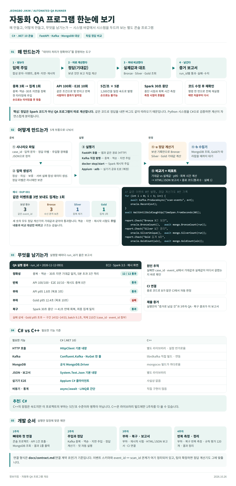
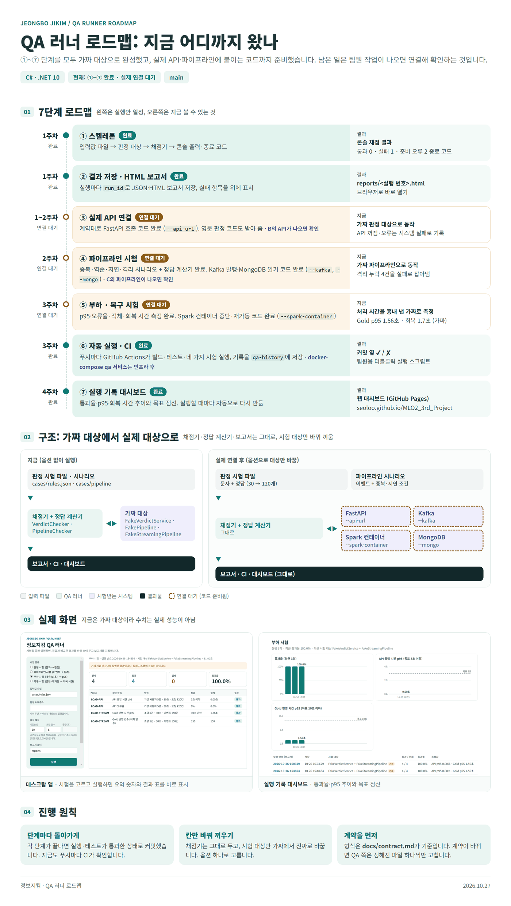
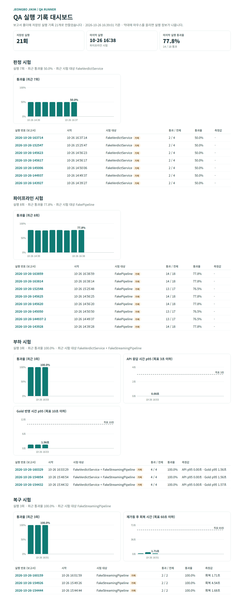

# 정보지킴 자동화 QA

> **처음 쓰는 팀원이라면 [설치·사용 안내](docs/install-and-use.md)부터 보세요.** 설치 방법 고르기, 첫 시험, 결과 읽는 법, 내 API 시험하기, 문제 해결까지 순서대로 정리했어요.

정보지킴(스미싱 판정 서비스)이 **정확하게 판정하고, 데이터를 빠짐없이 처리하고, 멈췄다가도 회복하는지**를 자동으로 확인하는 QA 도구입니다. 입력값과 정답을 파일에 적어 두면, 프로그램이 입력을 시험 대상에 넣고 돌아온 결과를 정답과 비교해 채점하고 보고서로 남깁니다.

같은 채점 엔진을 두 가지 방법으로 씁니다.

| 방법 | 누가 쓰나 | 무엇 |
|---|---|---|
| **데스크탑 앱** (`src/QaRunner.Desktop`) | 팀원 누구나 | 버튼으로 시험을 고르고 결과를 화면에서 바로 보는 Windows 앱 |
| **콘솔 프로그램** (`src/QaRunner`) | QA 담당, CI | 명령어로 시험을 돌리고 종료 코드로 성공·실패를 알림. 실제 Kafka·MongoDB·Spark 시험도 여기서 |

**목차**
[한눈에 보기](#한눈에-보기) ·
[진행 상황](#진행-상황) ·
[데스크탑 앱](#데스크탑-앱) ·
[팀원이 쓰는 방법](#팀원이-쓰는-방법) ·
[콘솔 프로그램](#콘솔-프로그램) ·
[시험 흐름](#시험-흐름) ·
[부하·복구 시험 기준](#부하복구-시험-기준) ·
[QA 도구 점검](#qa-도구-점검) ·
[실제 시스템에 연결하기](#실제-시스템에-연결하기) ·
[시험 케이스 작성법](#시험-케이스-작성법) ·
[보고서와 대시보드](#보고서와-대시보드) ·
[자동 검사 (CI)](#자동-검사-github-actions) ·
[AI 사례·팀 공유 스켈레톤](#ai-사례팀-공유-스켈레톤) ·
[폴더 구조](#폴더-구조) ·
[확장 방법](#확장-방법)

---

## 한눈에 보기



| 질문 | 답 |
|---|---|
| **왜 만드나** | 실행안의 핵심인 "데이터 처리가 정확하다"를 증명하기 위해서입니다. 중복 3회·역순·30초 지연·초당 5건 × 5분·Spark 30초 중단 같은 조건은 사람이 손으로 정확히 재현할 수 없고, 코드를 고칠 때마다 다시 확인해야 합니다. |
| **어떻게 하나** | ① 입력을 넣고 → ② 정답을 따로 계산하고 → ③ 시스템이 낸 실제 값을 꺼내 → ④ 비교해서 보고서로 남깁니다. 정답은 시스템 코드가 아니라 QA가 계산하므로, 시스템이 틀려도 정답은 오염되지 않습니다. |
| **무엇이 남나** | 실행 번호별 HTML·JSON 보고서, 통과율·p95·회복 시간 추이 대시보드, CI의 ✔/✘, 종료 코드(0 통과, 1 실패, 2 준비 오류) |
| **왜 C#인가** | HTTP·Kafka·MongoDB·JSON을 공식 라이브러리로 바로 쓸 수 있고, Python으로 만든 시스템과 언어가 달라 정답 계산이 자연스럽게 분리됩니다. 부하가 초당 5건 수준이라 C++의 속도는 필요하지 않습니다. |

시험은 무엇을 점검하는지에 따라 세 영역으로 나뉩니다. 보고서·대시보드·데스크탑 앱 모두 이 영역으로 묶어 보여 줍니다.

| 영역 | 시험 | 넣는 것 | 비교하는 것 |
|---|---|---|---|
| **서비스** | 판정 시험 (`verdict`) | 문자 | 판정 (고위험·주의·신호 미발견·판단 보류) |
| | 파이프라인 시험 (`pipeline`) | 이벤트 + 중복·역순·지연 조건 | Bronze 보관 건수, Silver 고유 건수, 격리 건수, Gold 60초 구간 집계 |
| | 부하 시험 (`load`) | 판정 API 동시 요청 + 이벤트를 초당 N건씩 계속 | API 응답 시간 p95, API 오류율, Gold 반영 시간 p95, 적체 |
| | 복구 시험 (`recovery`) | 이벤트를 계속 보내면서 처리를 멈췄다 재가동 | 재가동 후 회복 시간, 최종 집계 일치 |
| **앱** | 앱 화면 시험 (준비 중) | 앱 화면에 넣는 문자 | 화면에 나온 판정·근거·대응 안내. 앱이 나오면 붙임 |
| **QA 도구** | QA 도구 점검 (`selfcheck`) | 답을 이미 아는 입력 11가지 (코드에 고정) | 채점기가 틀린 결과를 잡아내는지, 정답 계산·p95·보고서 저장이 맞는지 |

그림의 보고서 화면 수치는 설명을 위한 예시입니다.

## 진행 상황

| 단계 | 내용 | 상태 |
|---|---|---|
| ① 스켈레톤 | 입력값 파일 → 가짜 판정 대상 → 채점 → 콘솔 출력·종료 코드 | 완료 |
| ② 결과 저장·HTML 보고서 | 실행 번호별 JSON·HTML 보고서 저장 | 완료 |
| ③ 실제 API 연결 | 계약 초안대로 FastAPI 호출 코드 완료 (`--api-url`). B의 API가 나오면 실제로 확인 | 연결 대기 |
| ④ 파이프라인 시험 | 가짜 파이프라인으로 동작 확인. Kafka 발행·MongoDB 읽기 코드 완료 (`--kafka`, `--mongo`) | 연결 대기 |
| ⑤ 부하·복구 시험 | 가짜 파이프라인으로 동작 확인. Spark 컨테이너 중단·재가동 코드 완료 (`--spark-container`) | 연결 대기 |
| ⑥ 자동 실행·CI | GitHub Actions에서 푸시마다 빌드·테스트·시험 실행. docker-compose 서비스는 인프라가 생긴 뒤 | 일부 완료 |
| ⑦ 실행 기록 대시보드 | 실행할 때마다 `reports/dashboard.html`을 다시 만들어 추이를 표시 | 완료 |
| 데스크탑 앱 | 홈·여정 안내·조건 시트·결과·기록·관리 화면을 갖춘 Windows 앱 | 완료 |
| 시험 영역 | 서비스 · 앱 · QA 도구로 시험을 묶음. QA 도구 점검 11가지 추가, CI에서 항상 통과해야 함 | 완료 (앱 영역은 준비 중) |
| AI 사례·팀 공유 | 예제 문자 → 채점 → 로컬 보고서 → 공유 API → 팀 기록 조회 뼈대. Runpod·EC2 연결 전 | 스켈레톤 |



- **연결 대기:** ③④⑤는 가짜 대상으로 다 돌아가고, 실제 시스템에 붙이는 코드도 준비되어 있습니다. 팀원 작업이 나오면 옵션(`--api-url`, `--kafka`, `--mongo`)만 넣어 확인합니다.
- **구조:** 채점기·정답 계산기·보고서는 바뀌지 않고, 시험 대상만 가짜에서 실제로 바꿔 끼웁니다.

---

## 데스크탑 앱

명령어 없이 화면에서 시험을 고르고 결과를 보는 Windows 앱입니다. 콘솔 프로그램과 같은 실행 절차(`QaRunService`)를 쓰므로 결과와 보고서도 똑같습니다.

```bash
dotnet run --project src/QaRunner.Desktop
```

### 처음 5분 따라 하기

앱을 켜면 **홈**이 열리고, 홈 위쪽의 **처음 사용하는 순서**(여정 지도)가 지금 할 일을 알려 줍니다. 아래 순서대로 하면 단계가 저절로 체크됩니다.

1. 홈의 **다음 할 일** 배너에서 **빠른 점검 고르기**를 누릅니다. ‘빠른 점검’ 카드를 눌러도 됩니다.
2. 오른쪽에 **조건 시트**가 열립니다. 시험 대상이 **연습용 대상**인지 확인하고 **시험 시작하기**를 누릅니다. 약 10초 뒤 **시험** 화면에 결과가 나옵니다.
3. 다른 값이 나온 항목을 골라 **예상 정답·기준**과 **실제 결과**를 비교하고, **보고서 열기**로 HTML 보고서를 엽니다.
4. **기록** 메뉴에서 지난 실행을 골라 다시 열어 봅니다.

내 판정 API를 시험하려면 조건 시트에서 **내 판정 API**를 고르고 주소(예: `http://localhost:8000`)를 넣습니다. 주소가 비었거나 잘못되면 실행하지 않고 시트 안에서 알려 줍니다.

모르는 버튼이나 입력칸에 마우스를 잠시 올리거나 Tab으로 선택하면 말풍선이 나옵니다. 왼쪽 아래 **사용 안내** 또는 **F1**에서 시작 순서와 기능 안내를 볼 수 있습니다.

### 화면 구성

왼쪽 메뉴는 **홈 · 시험 · 기록 · 관리** 네 개입니다. 기록과 관리는 위쪽 탭으로 나뉩니다. 제목 표시줄에 "정보지킴 QA / 메뉴 / 탭"으로 지금 위치가 나오고, 아래 상태 표시줄에 그 화면에서 할 일이 나옵니다.

| 메뉴 | 탭 | 하는 일 |
|---|---|---|
| 홈 | — | 인사말 · 처음 사용하는 순서(여정 지도 4단계) · 지금 단계에 맞춘 **다음 할 일** 배너 · 통과율/이번 주 실행/다시 볼 항목 요약 · **서비스 · 앱 · QA 도구** 영역 탭과 시험 카드(카드마다 최근 결과. 앱은 준비 중 안내) · 최근 실행 3건 |
| 시험 | — | 진행 상태와 결과(완료 카드 · 요약 숫자 · 항목별 결과 · 선택한 항목의 예상과 실제 비교) · 조건 바꾸기 · 보고서 열기 · 전체 추이 |
| 기록 | 내 기록 | 저장한 기록 수·평균 통과율·마지막 실행 요약 · 영역이 표시된 실행 목록에서 고르면 시험 화면에서 그때 결과를 다시 엶 |
| 기록 | 팀 공유 | 실행자·환경·버전·공유 방식 한 줄 · 왼쪽 실행 목록 · 오른쪽 사례별 비교 |
| 관리 | 시험 문자 | 왼쪽 문자 목록 · 오른쪽 예상 정답·정답 상태·판정 근거 |
| 관리 | AI 문자 | Runpod 연결 자리 (준비 중). 지금은 예제 문자 4건으로 연습 |
| 관리 | 설정 | 사례 파일 · API 주소 · 보고서 폴더 · 연결 상태 · 처음 사용하는 순서 다시 보기. 바꾼 값은 지금 켜 둔 앱에서만 적용 |

**오른쪽 조건 시트**는 홈의 시험 카드, 시험 화면의 **조건 바꾸기**, 결과가 없을 때의 **시험 고르기**로 엽니다. 시험 종류·시험 대상(연습용/내 판정 API)·사례 파일·시간·건수·보고서 위치를 확인하고, 걸리는 시간을 본 뒤 **시험 시작하기**를 누릅니다. X나 바깥을 누르면 닫힙니다.

- 처음 사용하는 순서는 저장하지 않습니다. 앱을 켤 때 이미 실행 기록이 있으면 앞의 두 단계(고르기·실행하기)는 끝낸 것으로 표시합니다. **관리 › 설정 › 처음부터 다시**로 되돌릴 수 있습니다.
- 부하·복구 시험은 화면에서 바로 보여 주기 좋게 기본 시간을 짧게 잡았습니다(부하 30초, 복구 60초·15초 중단). 시트에서 숫자를 바꾸면 실행안 기준(부하 300초, 복구 120초·30초 중단)으로도 돌릴 수 있습니다.
- 데스크탑 앱에서는 판정 API 주소만 넣을 수 있습니다. 실제 Kafka·MongoDB·Spark 시험은 [콘솔 프로그램](#콘솔-프로그램)으로 돌립니다.
- 입력 경로와 보고서 폴더는 `qa/` 폴더 기준입니다. 실행 파일을 어디서 열어도 `qa/` 폴더를 찾아 기준으로 삼습니다.

### 결과 읽는 법

| 표시 | 뜻 |
|---|---|
| **통과** | 예상 정답과 같거나 측정 기준을 만족 |
| **불일치** | 예상과 다른 값을 받음 |
| **기준 미달** | 측정한 값이 기준(예: p95 3초)을 넘음 |
| **응답 없음** | 시험 대상이 결과를 돌려주지 못함 (연결 실패, 시간 초과 등). 판정이 틀린 것과 구분 |

- **연습용 대상**에는 일부러 틀리는 규칙이 들어 있습니다(가짜 판정기는 "인증번호"만 보고, 가짜 파이프라인은 격리를 하지 않음). 채점기가 틀린 결과를 잡아내는지 보는 용도이며, 완료 카드에 "연습용 대상" 표시가 붙습니다. 판정 API와 연습용 파이프라인을 섞어 쓴 경우에만 노란 안내를 따로 띄웁니다.
- 아직 사람이 검토하지 않은 정답(예제·AI 문자)과 비교한 기록은 "정답 검토 전"으로 따로 표시합니다.

시험 중에는 결과 자리에 **진행 카드**가 나옵니다. 어떤 시험을 무엇을 하며 돌리는지, 지난 시간, 부하·복구 시험은 보내기까지 남은 시간과 진행 막대, 지금 단계(입력 보내기 → 결과 모으기 → 채점·보고서 저장)를 보여 주고, 상태 표시줄은 민트 띠로 바뀝니다.

시험이 끝나면 세 곳에서 알려 줍니다.

| 위치 | 모양 |
|---|---|
| 결과 맨 위 **완료 카드** | 민트 그라데이션 카드에 "시험이 끝났어요", 요약, **보고서 열기·다시 실행** 버튼. 연습용 대상이면 "연습용 대상" 표시를 붙임. 기록에서 다시 연 결과는 "지난 실행 결과예요"로 나옴 |
| 맨 아래 **상태 표시줄** | 모두 통과면 초록, 다시 볼 항목이 있으면 주황, 응답 없음이나 오류면 빨강 띠로 바뀌고 **보고서 열기·폴더 열기** 버튼이 붙음. 다른 메뉴로 가면 평소 모양으로 돌아옴 |
| 결과 표의 **다음 행동 말풍선** | 첫 번째 줄을 가리키며 무엇을 누를지 알려 줌. 앱을 켠 뒤 처음 3번만 나오고, 표를 누르거나 **알겠어요**를 누르면 닫힘. **처음부터 다시**를 누르면 다시 3번 나옴 |

### 창과 화면 크기

- 오른쪽 위 **최소화·최대화/이전 크기로·닫기** 버튼을 씁니다. 제목 표시줄을 드래그하면 이동, 더블클릭하면 최대화/복원합니다. 가장자리·모서리·오른쪽 아래 손잡이로 크기를 조절합니다.
- 기본 창은 1120 × 740이며, 시작할 때 모니터 작업 영역과 Windows DPI에 맞춰 크기·위치를 보정합니다. 창 크기에 따라 본문 배율이 75~100%로 자동 조정되고 오른쪽 아래에 표시됩니다. 더 작은 창은 스크롤합니다.
- Windows 전용입니다(WPF). 맥·리눅스에서는 콘솔 프로그램을 씁니다.

### 화면 디자인 규칙

[WPF UI](https://github.com/lepoco/wpfui) 4.3.0의 밝은(Light) 컨트롤에 **민트 프레시** 색을 입혔습니다. 화면을 고치거나 추가할 때는 `DesktopTheme.xaml`의 값을 씁니다.

| 항목 | 규칙 |
|---|---|
| 색 | 강조 청록 `#0D9488` 한 가지(기본 버튼·선택·링크), 홈 배너와 결과 완료 카드만 청록→초록 그라데이션. 본문 바탕 `#F3F8F7`, 메뉴·카드 `#FFFFFF`, 선 `#DDEDEA`, 선택 `#E6FAF6`. 글자 `#0F2A27`, 보조 글자 `#5B706C`. 결과 색은 통과 `#15803D` · 실패 `#BE123C` · 주의 `#B45309`로 테마와 관계없이 고정 |
| 카드 | 홈·결과는 둥근 모서리 20 + 옅은 그림자(`SoftCard`), 시험 카드는 `SuiteCard`(마우스를 올리면 청록 테두리). 설정 한 줄은 `CardControl`(`SettingCard`) |
| 버튼 | 화면마다 주요 동작 하나만 `PrimaryButton`. 나머지는 `SecondaryButton`(높이 32)·`TextButton`. 배너 위는 흰 알약 `PillButton`, 시트의 시작 버튼은 높이 48 알약 |
| 아이콘·알림 | WPF UI `SymbolIcon`(Fluent System Icons), 고르면 채운 아이콘. 안내·경고·오류는 `InfoBar`. 시험 중에는 진행 카드와 민트 띠, 시험 완료는 완료 카드와 상태 표시줄 색 띠(통과 초록 · 다시 볼 항목 주황 · 오류 빨강)로 알림 |
| 간격·글자 | 간격 4·8·12·16·20·24·32, 글자 12·13·14·16·20·22·26. 본문 여백 좌우 32, 왼쪽 메뉴 폭 212 |
| 목록 | 카드 안에 테두리 없이 행 높이 40. 건수·시간은 `NumberCell`로 오른쪽 정렬, 긴 값은 `TrimmedCell`로 말줄임 + 말풍선, 빈 목록은 `EmptyListText` 안내 |
| 상태 표시 | 고른 항목은 옅은 청록 바탕 + 왼쪽 강조선(`SelectableListItem`). 짧은 상태는 `StatusBadge`(확인 완료 초록, 확인 전 노랑) |
| 배경 이미지 | 홈 배너는 `Assets/Backgrounds/`의 압축 이미지 20개 중 한 장을 무작위로 골라 그 한 장만 읽고, 위에 그라데이션을 덮음. 출처와 라이선스는 `THIRD-PARTY-NOTICES.txt` |

### 화면 캡처와 UI 점검

README·발표 자료용 화면이 필요하면 캡처 모드로 실행합니다. 창을 화면 밖에 띄워 시험을 한 번 돌리고 PNG를 저장한 뒤 바로 꺼집니다. 캡처 경로는 저장소 밖으로 지정하세요.

```bash
dotnet run --project src/QaRunner.Desktop -- --capture C:/Temp/screen.png --suite load --page run
```

`--page`에는 `home`, `run`, `reports`, `team`, `cases`, `ai`, `settings`를 쓸 수 있습니다(생략하면 `run`).

`--ui-smoke`는 실제 화면 컨트롤을 눌러 보며 88가지를 점검하고, 단계별 PNG와 `ui-smoke.json`을 저장합니다. 메뉴·탭 이동, 홈 영역 탭(서비스·앱·QA 도구), 홈 카드 → 조건 시트, 주소 오류 안내, 다섯 종류 시험(QA 도구 점검 포함) 실행·보고서 저장, 시험 중 진행 카드, 완료 카드·상태 표시줄 색 띠·다음 행동 말풍선, 중복 실행 차단, 여정 단계 체크, 팀 공유, 기록 다시 열기, 최소 창 크기, Windows용 Kafka 라이브러리 로드까지 확인합니다. 보고서는 지정한 폴더 안의 `reports/`에만 남깁니다.

```bash
dotnet run --project src/QaRunner.Desktop -- --ui-smoke C:/Temp/qa-ui-review
```

---

## 팀원이 쓰는 방법

설치부터 첫 시험까지 따라 하는 자세한 설명은 [설치·사용 안내](docs/install-and-use.md)에 있습니다. 이 절은 QA 담당이 배포 방식을 관리할 때 보는 요약입니다.

| 하고 싶은 것 | 방법 | 필요한 것 |
|---|---|---|
| 결과만 보기 | 웹 대시보드 **https://seoloo.github.io/MLO2_3rd_Project/** 열기 | 없음 (브라우저만) |
| 배포 파일로 시험 돌리기 | `QA-windows-x64.zip`을 풀고 `QaRunner.Desktop.exe` 실행 | Windows x64, .NET 10 Desktop Runtime(x64) |
| 직접 시험 돌리기 (예: 내 API 시험) | `qa/run-qa-desktop.cmd` 더블클릭 | 처음 한 번: .NET 10 SDK 설치, 저장소 clone |

### 결과만 보기: 웹 대시보드

- 기본 브랜치(`main`)에 푸시할 때마다 GitHub Actions가 네 가지 시험을 돌리고, 실행 기록을 `qa-history` 브랜치에 쌓은 뒤 대시보드를 GitHub Pages에 올립니다.
- 대시보드의 실행 번호를 누르면 그 실행의 상세 보고서가 열립니다.
- 웹 대시보드는 CI 기록만 보여 줍니다. 각자 PC에서 돌린 기록은 각자의 `qa/reports/dashboard.html`에 쌓입니다.

### 배포 파일로 실행하기

QA 담당자가 `qa/publish-qa-desktop.cmd`를 더블클릭하면 `qa/dist/QA-windows-x64.zip`이 만들어집니다. .NET 10 SDK가 필요하며, 이 명령은 Git에서 코드를 받거나 푸시하지 않습니다.

1. ZIP을 [GitHub Releases](https://github.com/seoloo/MLO2_3rd_Project/releases)에 새 릴리스로 올려 링크를 공유합니다. 태그는 `qa-v<주>.<부>.<수>` 형식(예: `qa-v1.0.0`)으로 붙이고, 바뀐 점을 릴리스 설명에 적습니다. 메신저로 ZIP을 직접 보내면 누가 어느 버전을 쓰는지 알기 어렵습니다.
2. 팀원은 ZIP을 쓸 수 있는 폴더에 **전부 압축 해제**합니다. ZIP에는 실행 파일, `cases` 폴더, 라이선스 안내, [설치·사용 안내](docs/install-and-use.md)가 들어 있습니다.
3. 처음 한 번 .NET 10 Desktop Runtime(x64)을 설치하고 `QaRunner.Desktop.exe`를 실행합니다. SDK는 필요하지 않습니다.

```powershell
winget install Microsoft.DotNet.DesktopRuntime.10
```

실행 기록은 압축을 푼 폴더의 `reports/`에 저장됩니다. 배포 파일에는 팀원 간 원격 동기화 기능이 없습니다.

2026-10-29 로컬 Release 빌드 기준 크기입니다. 기능이 늘어나면 달라집니다.

| 구성 | 크기 |
|---|---:|
| JPEG 배경 20개 합계 (실행 파일에 포함) | 3.23 MiB |
| Windows x64 실행 파일 | 27.40 MiB |
| 배포 폴더 전체 (실행 파일 · cases · 라이선스 안내) | 27.40 MiB |
| 전달용 ZIP (설치·사용 안내 포함) | 12.59 MiB |

- 배포본은 Windows x64만 묶고 .NET 실행 환경은 따로 설치합니다. 다른 운영체제용 바이너리는 소스 의존성을 유지한 채 이 배포본에서만 뺍니다.
- Kafka·MongoDB 라이브러리, Spark 연결 코드, Runpod·EC2 확장 구조는 삭제하지 않습니다. Windows용 Kafka 네이티브 라이브러리는 실행 파일에 포함하고, UI 점검에서 실제 로드를 확인합니다.
- WPF와 이후 확장을 위해 트리밍은 쓰지 않습니다.
- `dist/`·빌드 결과·ZIP은 Git에 올리지 않습니다. 앱이 실제로 쓰는 압축 배경 이미지는 소스에 포함합니다.

### 직접 돌리기: run-qa-desktop.cmd

처음 한 번 .NET 10 SDK를 설치하고 저장소를 받습니다.

```bash
winget install Microsoft.DotNet.SDK.10
```

```bash
git clone https://github.com/seoloo/MLO2_3rd_Project.git
```

그다음부터는 탐색기에서 `qa/run-qa-desktop.cmd`를 **더블클릭**합니다. 매번 ① 최신 코드 받기(`git pull`, 고치던 파일이 있으면 안내만 하고 계속) → ② 데스크탑 앱 빌드 → ③ 앱 실행 순서로 동작합니다. 앱이 이미 켜져 있으면 빌드할 수 없으니 먼저 닫으라고 안내합니다. 빌드가 실패하면 오류를 보여 주고 멈추므로, 그 내용을 QA 담당에게 알려 주세요.

---

## 콘솔 프로그램

### 설치

```bash
winget install Microsoft.DotNet.SDK.10
```

터미널을 새로 열고 버전이 `10.0.`으로 시작하는지 확인합니다.

```bash
dotnet --version
```

### 실행

명령은 모두 `qa/` 폴더에서 실행합니다.

```bash
dotnet run --project src/QaRunner
```

```bash
dotnet run --project src/QaRunner -- --suite pipeline
```

지금은 일부러 엉성하게 만든 가짜 대상으로 돌기 때문에 실패가 나옵니다. 판정 시험은 4건 중 2건, 파이프라인 시험은 5분 초과 도착·같은 ID 상충 관련 4건이 실패합니다. 채점기가 틀린 결과를 잡아내는지 보는 것입니다.

부하·복구 시험은 실행안 기준으로 기본 5분(부하), 2분(복구)이 걸립니다. 짧게 확인하려면 시간을 줄입니다.

```bash
dotnet run --project src/QaRunner -- --suite load --duration 10
```

```bash
dotnet run --project src/QaRunner -- --suite recovery --duration 20 --stop-seconds 5
```

QA 러너 자체의 테스트:

```bash
dotnet test
```

### 옵션

옵션은 `--` 뒤에 붙입니다. 생략하면 기본값을 씁니다.

| 옵션 | 뜻 | 기본값 |
|---|---|---|
| `--suite` | 시험 종류. `verdict`, `pipeline`, `load`, `recovery`, `selfcheck` | `verdict` |
| `--cases` | 판정·부하 시험은 입력값 파일, 파이프라인 시험은 시나리오 폴더 (복구 시험은 안 씀) | `cases/rules.json` / `cases/pipeline` |
| `--reports` | 보고서를 저장할 폴더 | `reports` |
| `--api-url` | 판정 API 주소. `http://` 또는 `https://`로 시작 (판정·부하 시험) | 없음 (가짜 판정 대상) |
| `--duration` | 부하·복구 시험에서 이벤트를 보내는 시간(초) | 부하 300 / 복구 120 |
| `--rate` | 부하·복구 시험에서 1초에 보내는 이벤트 수 | 5 |
| `--stop-seconds` | 복구 시험에서 처리를 멈춰 두는 시간(초). 전체 시간의 1/4 지점에서 멈춤 | 30 |
| `--kafka` | 실제 Kafka 주소. `--mongo`와 함께 주면 실제 파이프라인을 대상으로 시험 | 없음 (가짜 파이프라인) |
| `--mongo` | 실제 MongoDB 연결 문자열 | 없음 |
| `--kafka-topic` | 이벤트를 넣을 토픽 | `scan-events` |
| `--mongo-db` | 메달리온 컬렉션이 있는 데이터베이스 | `jeongbo` |
| `--spark-container` | 복구 시험에서 멈췄다 켤 Spark 컨테이너 | `spark` |

### 종료 코드

CI가 성공·실패를 판단할 때 씁니다.

| 종료 코드 | 뜻 |
|---|---|
| `0` | 모든 항목 통과 |
| `1` | 실패한 항목이 하나 이상 있음 (응답 없음 포함) |
| `2` | 채점을 시작하지 못함 (옵션·측정 숫자 오류, 입력 파일·시나리오 폴더 없음/형식 오류, API 주소 오류, 실제 MongoDB를 읽지 못함) |

---

## 시험 흐름

### 판정 시험

```
입력값 파일 ──(문자)──▶ 판정 대상 ──(실제 판정)──▶ 채점 ──▶ 결과 (화면 · 보고서 · 종료 코드)
     └──────────────(정답)─────────────────────────┘
```

### 파이프라인 시험

```
시나리오 ──▶ 전송 계획 ──(이벤트)──▶ 파이프라인 ──(실제 건수)──▶ 채점 ──▶ 결과
               └──▶ 정답 계산기 ──(정답 건수)───────────────────┘
```

### 부하·복구 시험

```
일정한 속도로 보내기 ──(이벤트)──▶ 파이프라인 ──▶ Gold
        │                                          │ 0.5초마다 건수 확인
        └──(보낸 시각)──▶ 반영 추적기 ◀──(늘어난 건수)─┘ → 반영 시간 p95, 회복 시간
```

- 정답은 시험 대상을 거치지 않습니다. 판정 시험은 사람이 적어 둔 정답을, 파이프라인 시험은 정답 계산기가 "보낸 기록"만 보고 계산한 정답을 씁니다.
- 시험 대상은 바꿔 끼울 수 있습니다. 지금은 가짜(`FakeVerdictService`, `FakePipeline`, `FakeStreamingPipeline`)로 돌고, 실제 API·파이프라인이 준비되면 그 부분만 바꿉니다.

## 부하·복구 시험 기준

실행안의 초기 목표를 그대로 잽니다. 목표는 실측 전 기준이라, 미달하면 조건·원인과 함께 그대로 남깁니다.

| 시험 | 확인 항목 | 목표 | 재는 방법 |
|---|---|---|---|
| 부하 | API 응답 시간 p95 | 3초 이하 | 가상 사용자 5명이 판정 API를 동시에 계속 부름 (응답 후 0.2초 쉬고 다음 요청) |
| 부하 | API 오류율 | 0% | 위 요청 중 연결 실패·오류 응답·시간 초과 비율 |
| 부하 | Gold 반영 시간 p95 | 10초 이하 | 이벤트를 보낸 시각부터 Gold 건수에 잡힌 시각까지 |
| 부하 | Gold 반영 건수 (적체 없음) | 보낸 건수와 같음 | 보내기가 끝나고 최대 60초 기다린 뒤 Gold에 반영된 건수 |
| 복구 | 재가동 후 회복 시간 | 60초 이하 | 재가동한 시각부터, 그때까지 보낸 이벤트가 모두 Gold에 반영된 시각까지 |
| 복구 | 최종 Gold 반영 건수 (집계 일치) | 보낸 건수와 같음 | 보내기가 끝나고 최대 60초 기다린 뒤 Gold에 반영된 건수 |

- **p95**는 "100건 중 95번째로 느린 건의 시간"입니다. 95%가 이 시간 안에 끝났다는 뜻이라 평균보다 체감 속도를 잘 보여 줍니다.
- **Gold 반영 시간은 근삿값입니다.** 0.5초마다 Gold 건수를 읽고, 늘어난 만큼 먼저 보낸 이벤트부터 반영된 것으로 봅니다. 실제 MongoDB에서도 같은 방식으로 잴 수 있지만, 다른 데이터가 섞이면 안 되므로 시험 환경에서 돌려야 합니다.
- **지금은 가짜 파이프라인(`FakeStreamingPipeline`)으로 돕니다.** 받은 이벤트를 1초 뒤에 반영하고 1초에 최대 20건까지 처리하며, 멈추라고 하면 받기만 합니다. 측정 코드가 맞게 도는지는 확인할 수 있지만 수치 자체는 실제 성능이 아닙니다.

## QA 도구 점검

"QA가 틀리면 QA 결과도 믿을 수 없다"는 문제를 막으려고, QA 러너가 다른 시스템을 채점하기 전에 **답을 이미 아는 입력으로 자기 자신을 점검**합니다. 입력은 `SelfCheck/QaToolSelfChecker.cs` 안에 고정해 두어 사례 파일을 고쳐도 결과가 바뀌지 않고, 외부 연결 없이 1초 안에 끝납니다.

```bash
dotnet run --project src/QaRunner -- --suite selfcheck
```

| 번호 | 확인하는 것 | 넣는 것 → 기대하는 결과 |
|---|---|---|
| SC-01 | 판정 채점기 분류 | 맞는 판정·틀린 판정·응답 오류 각 1건 → 통과 1 · 불일치 1 · 응답 없음 1 |
| SC-02 | 결함 잡아내기 · 판정 | ‘인증번호’만 보는 연습용 판정기에 앱 설치 요구 문자 → 불일치로 잡아냄 |
| SC-03 | 결함 잡아내기 · 파이프라인 | 격리를 하지 않는 연습용 파이프라인에 6분 늦은 이벤트 → 격리 건수 불일치로 잡아냄 |
| SC-04~06 | 정답 계산 (중복·늦은 도착·같은 ID 상충) | Bronze·Silver·격리 건수가 실행안 규칙과 같음 |
| SC-07 | 정답 계산 · Gold 60초 구간 | 00:10·00:50·01:10 이벤트 → 2개 구간 · 2건 / 1건 |
| SC-08 | p95 계산 | 1~100초 100건 → 95.00초 |
| SC-09 | 판정 코드 변환 | `HIGH_RISK` 등 4개 → 고위험·주의·신호 미발견·판단 보류 |
| SC-10 | 보고서 저장 후 다시 읽기 | 임시 폴더에 저장한 실행 기록을 다시 읽어 건수·영역·HTML 내용이 같음 |
| SC-11 | 실행 번호 겹침 방지 | 같은 초의 보고서가 있으면 `-2`를 붙임 |

- 서비스 영역 시험과 달리 **항상 통과해야 합니다.** CI에서 하나라도 실패하면 검사가 실패합니다.
- 점검 코드에서 예외가 나면 그 항목만 "시스템 실패"로 남기고 나머지는 계속 돌립니다.
- QA 러너 단위 시험(`dotnet test`)과 화면 점검(`--ui-smoke`)은 개발자용 점검으로 따로 돌고, 데스크탑 앱 홈의 **QA 도구** 탭에 함께 안내합니다.

## 실제 시스템에 연결하기

형식은 모두 [docs/contract.md](../docs/contract.md)(연결 계약 초안)를 따릅니다. 옵션을 주지 않으면 가짜 대상으로, 주면 실제 시스템으로 시험합니다.

| 시험 | 실제 대상 | 옵션 |
|---|---|---|
| 판정 | B의 판정 API | `--api-url http://localhost:8000` (데스크탑 앱은 조건 시트의 ‘내 판정 API’) |
| 파이프라인 | Kafka + MongoDB | `--kafka localhost:9092 --mongo mongodb://localhost:27017` |
| 부하 | API 부하는 `--api-url`, 스트림 부하는 `--kafka`·`--mongo` | 둘을 따로 또는 함께 |
| 복구 | Kafka + MongoDB + Spark 컨테이너 | `--kafka`·`--mongo` (+ `--spark-container`, 기본 `spark`) |

### 판정 API (계약 3장)

| 구분 | 내용 |
|---|---|
| 요청 | `POST {API 주소}/checks`, 본문 `{ "message": "문자 내용" }` |
| 응답 | `200 OK`, 본문의 `verdict`만 읽음. 영문 코드(`HIGH_RISK`)와 한글(`고위험`) 둘 다 받아서 한글로 바꿔 비교 |
| 시간 제한 | 10초 |

API가 꺼져 있거나, 오류 응답(4xx·5xx)이 오거나, 10초 안에 답이 없거나, 응답에 `verdict`가 없으면 그 케이스는 **응답 없음(시스템 실패)**으로 기록하고 다음 케이스로 넘어갑니다. 예상 정답은 API에 보내지 않습니다.

### Kafka·MongoDB·Spark (계약 4~6장)

| 단계 | QA가 하는 일 |
|---|---|
| 보내기 | 시나리오 이벤트를 계약 형식(`source: "qa"`, `runId`, `caseId` 포함)으로 `scan-events` 토픽에 발행. 이벤트 번호 앞에 실행 번호를 붙여 실행끼리 겹치지 않게 함 |
| 읽기 | `bronze_events`·`silver_events`·`quarantine_events`에서 이번 실행·시나리오 건수, `gold_metrics`에서 구간별 `total`을 읽음 |
| 멈추고 켜기 | 복구 시험에서 `docker stop spark` → `docker start spark` |

- 실제 파이프라인 시험은 **다른 데이터가 섞이지 않는 시험 환경**에서 돌립니다. Gold는 구간별로 모든 이벤트를 합치기 때문입니다.
- Kafka에 보내지 못하면 그 시나리오를 시스템 실패로 기록합니다. MongoDB를 읽지 못하면 채점 자체가 안 되므로 종료 코드 2로 끝납니다.

## 시험 케이스 작성법

### 판정 시험 (`cases/rules.json`)

케이스 하나가 한 줄입니다. 줄을 추가하면 코드를 고치지 않아도 채점 대상이 늘어납니다.

```json
[
  { "caseId": "R-001", "message": "[택배] 상담원에게 인증번호를 알려주세요", "expectedVerdict": "고위험" },
  { "caseId": "R-005", "message": "입력할 문자", "expectedVerdict": "주의" }
]
```

| 키 | 뜻 | 규칙 |
|---|---|---|
| `caseId` | 케이스 번호 | 겹치지 않게. 실패했을 때 이 번호로 찾음 |
| `message` | 판정 대상에 넣을 문자 | 실제 사용자 문자가 아닌 시험용으로 만든 문자 |
| `expectedVerdict` | 정답 판정 | `고위험`, `주의`, `신호 미발견`, `판단 보류` 중 하나 |

정답 라벨은 A와 B가 함께 정하고 PR로 검토받아 넣습니다. 데스크탑 앱의 **관리 › 설정 › 시험 문자 파일**에서 다른 파일을 골라 쓸 수도 있습니다.

### 파이프라인 시나리오 (`cases/pipeline/*.json`)

파일 하나가 시나리오 하나입니다. 폴더에 파일을 추가하면 다음 실행부터 함께 채점합니다. **정답은 적지 않습니다.** 정답 계산기가 보낸 이벤트를 보고 직접 계산합니다.

```json
{
  "caseId": "DUP-001",
  "description": "같은 이벤트를 3번 보내도 Silver·Gold에는 1건만 남는다",
  "events": [
    { "eventId": "dup-001-e1", "scanId": "dup-001-s1", "offsetSeconds": 0, "verdict": "고위험" }
  ],
  "injection": { "duplicateCount": 3 }
}
```

| 키 | 뜻 |
|---|---|
| `caseId` | 시나리오 번호 |
| `description` | 무엇을 확인하는 시나리오인지. 보고서의 입력 칸에 나옴 |
| `events[].eventId` | 이벤트 고유 번호. 같은 번호를 다른 내용으로 두 번 적으면 "같은 ID 상충" 시나리오 |
| `events[].scanId` | 검사 번호 (Kafka 메시지 키) |
| `events[].offsetSeconds` | 시나리오 시작 기준 몇 초 뒤에 일어난 이벤트인지 |
| `events[].verdict` | 판정 (생략하면 `신호 미발견`) |
| `injection.duplicateCount` | 같은 이벤트를 몇 번 보낼지 (생략하면 1) |
| `injection.sendInReverseOrder` | `true`면 나중 이벤트부터 거꾸로 보냄 |
| `injection.delaySeconds` | 몇 초 늦게 도착시킬지. 300초를 넘으면 격리 대상 |

지연은 실제로 기다리지 않고 이벤트 시각을 과거로 당겨서 만들기 때문에, 6분 지연 시나리오도 바로 끝납니다.

| 지금 들어 있는 시나리오 | 확인하는 것 |
|---|---|
| `DUP-001` | 3번 중복 전송 → Bronze 3, Silver 1 |
| `ORDER-001` | 역순 도착 → 모두 집계 |
| `DELAY-001` | 30초 지연 → 원래 구간에 집계 |
| `LATE-001` | 6분 지연 → 격리, Gold에 집계 안 됨 |
| `CONFLICT-001` | 같은 event_id가 다른 내용으로 도착 → 뒤에 온 것 격리 |

### 정답 계산 규칙

정답 계산기(`Pipeline/ExpectedResultCalculator.cs`)는 실행안 기준으로 계산합니다. 일부는 C와 확정하기 전의 임시안입니다.

| 대상 | 규칙 |
|---|---|
| Bronze | 받은 이벤트를 모두 보관. 중복 전송도 각각 남음 |
| Silver | 같은 event_id는 한 번만 남김 |
| 격리 | 이벤트 시각보다 5분 넘게 늦게 도착했거나, 같은 event_id인데 내용이 다르면 격리 (임시안: 먼저 온 내용을 기준으로 뒤에 온 것을 격리) |
| Gold | Silver에 남은 이벤트를 이벤트 시각 기준 60초 구간별로 셈 |

Gold는 시나리오별로 나뉘지 않고 구간별로 합쳐지므로 실행 전체를 대상으로 한 번에 비교합니다(보고서의 케이스 `전체`).

## 보고서와 대시보드

실행할 때마다 보고서 폴더(기본 `reports/`)에 실행 번호로 파일이 생깁니다. 실행 번호는 시작 시각입니다(예: `2026-10-29-143015`). 같은 초에 다시 실행하면 `-2`, `-3`이 붙어 덮어쓰지 않습니다. 팀 공유 실행은 여러 PC에서 겹치지 않도록 UUID를 씁니다. 이 폴더는 Git에 올라가지 않습니다.

| 파일 | 용도 |
|---|---|
| `<실행 번호>.html` | 브라우저로 여는 보고서. 전체·통과·실패·통과율과 확인 항목별 결과 |
| `<실행 번호>.json` | 같은 내용을 대시보드·CI·데스크탑 앱이 읽는 용도 |
| `dashboard.html` | 폴더에 쌓인 모든 실행 기록을 모은 대시보드. 실행할 때마다 다시 만듦 |
| `team-runs/<UUID>.json` | 팀 공유 실행의 스냅샷 (재현·재전송용) |

보고서 표는 `케이스 · 확인 항목 · 입력 · 정답 · 실제 · 결과`로 되어 있고, 실패한 항목이 위에 먼저 나옵니다. 값을 못 받은 항목은 실제 값이 "시스템 실패"로 나오고 이유(연결 실패, 시간 초과 등)가 붙습니다. 가짜 시험 대상으로 실행한 보고서에는 "실제 시스템의 성능이 아닙니다"라는 안내가 붙습니다.

### 실행 기록 대시보드

`reports/dashboard.html`을 브라우저로 열면 지금까지 돌린 시험의 추이를 볼 수 있습니다. 데스크탑 앱의 **전체 추이** 버튼으로도 열립니다. CI 기록은 [웹 대시보드](https://seoloo.github.io/MLO2_3rd_Project/)에서 봅니다.



| 구역 | 내용 |
|---|---|
| 맨 위 | 저장된 실행 수, 마지막 실행 시각, 마지막 실행 통과율 |
| 시험 종류별 | 통과율 추이 막대 (최근 20회) |
| 부하 시험 | API 응답 시간 p95, Gold 반영 시간 p95 추이와 목표 점선 |
| 복구 시험 | 재가동 후 회복 시간 추이와 목표 점선 |
| 시험 종류별 표 | 최근 10회 실행 (실행 번호를 누르면 그 HTML 보고서로 이동, 가짜 대상이면 "가짜" 표시) |

- 저장된 JSON 보고서만 읽습니다. 보고서를 지우면 대시보드에서도 빠집니다.
- 막대에 마우스를 올리면 그 실행의 시각·값·시험 대상이 나옵니다.
- 결과 형태를 통일하기 전에 만든 옛 보고서는 건너뜁니다.
- 위 그림은 가짜 대상으로 돌린 기록입니다. 판정 50%·파이프라인 약 77%는 가짜 대상의 틀린 규칙을 채점기가 잡아낸 결과이고, 부하·복구 수치는 실제 성능이 아닙니다.

## 자동 검사 (GitHub Actions)

`qa/` 폴더나 `.github/workflows/qa.yml`이 바뀐 커밋을 `main`, `qa`, `feature/**` 브랜치에 푸시하거나 `main`으로 PR을 열면 GitHub가 자동으로 검사합니다.

| 순서 | 하는 일 | 실패로 보는 경우 |
|---|---|---|
| 1 | `qa-history` 브랜치에서 지난 실행 기록 가져오기 (없으면 건너뜀) | — |
| 2 | .NET 10 설치 후 빌드 (Windows 환경, 데스크탑 앱 포함) | 빌드 오류 |
| 3 | `dotnet test` | 테스트가 하나라도 실패 |
| 3-1 | QA 도구 점검(`--suite selfcheck`) | 점검이 하나라도 실패 (종료 코드 0이 아님) |
| 4 | 판정·파이프라인 시험, 부하 시험(10초 축소판), 복구 시험(20초 축소판) 실행 | 채점을 시작하지 못함 (종료 코드 2) |
| 5 | **기본 브랜치일 때만:** 실행 기록을 `qa-history` 브랜치에 저장 | 푸시 실패 |
| 6 | 보고서를 결과물(Artifacts `qa-reports`)로 첨부 | — |
| 7 | **기본 브랜치일 때만:** 대시보드를 GitHub Pages에 공개 | Pages 설정이 안 되어 있음 |

- 결과는 저장소의 **Actions** 탭이나 커밋 옆 ✔·✘에서 봅니다. **Run workflow** 버튼으로 직접 돌릴 수도 있습니다.
- `qa-history` 브랜치는 CI가 실행 기록만 쌓아 두는 별도 브랜치입니다. 사람이 직접 고치지 않습니다.
- 웹 대시보드를 공개하려면 처음 한 번 **Settings → Pages → Source**를 **GitHub Actions**로 바꿔야 합니다.
- 보고서·대시보드 시각은 한국 시간입니다.
- 지금은 가짜 대상이라 서비스 영역 시험 실패(종료 코드 1)가 정상이므로 검사 실패로 치지 않습니다. 반면 QA 도구 점검은 답을 이미 아는 입력이라 항상 통과해야 하므로 실패하면 바로 검사 실패입니다. 실제 API·파이프라인을 연결하면 `qa.yml`에서 종료 코드 1도 실패로 바꿉니다.
- 공개 저장소라서 GitHub Actions 사용 시간은 차감되지 않습니다.

## AI 사례·팀 공유 스켈레톤

후속 개발을 위한 뼈대입니다. 데스크탑 앱에서 **예제 문자 → 기존 판정 채점 → 로컬 보고서 → 공유 API → 팀 기록 조회** 흐름을 확인할 수 있습니다. Runpod 호출, AWS 자원 생성, 실제 팀원 간 원격 동기화는 아직 하지 않습니다.

1. **관리 › 시험 문자**에서 **예제 4건**을 누릅니다. 미리 만든 합성 문자 4건이며 AI가 만든 문자는 아닙니다.
2. **예제 시험하고 공유**를 누르면 연습용 판정기로 채점하고 결과를 공유한 뒤 **기록 › 팀 공유**로 이동합니다.
3. 실행 목록에서 하나를 고르면 사례별 예상 정답과 실제 판정이 나옵니다.

공유 방식은 **이 앱 안에서만 확인**(메모리)과 **같은 PC의 공유 서버**(`dotnet run --project src/QaRunner.Sharing.Api`, `127.0.0.1:5085`) 두 가지입니다. 데이터 계약, 공유 API 경로, 후속 작업 순서는 [연결 스켈레톤 안내](docs/collaboration-skeleton.md)에 있습니다.

---

## 폴더 구조

```
qa/
├─ QaRunner.slnx                     솔루션 (아래 프로젝트 5개)
├─ run-qa-desktop.cmd                팀원용: 최신 코드 받기 → 빌드 → 데스크탑 앱 켜기 (더블클릭)
├─ publish-qa-desktop.cmd            QA 담당용: Windows x64 배포 파일과 ZIP 만들기 (dist/, Git 제외)
├─ cases/
│   ├─ rules.json                    판정 시험 입력값 + 정답
│   └─ pipeline/*.json               파이프라인 시험 시나리오
├─ docs/install-and-use.md           팀원용 설치·사용 안내 (배포 ZIP에도 함께 들어감)
├─ docs/collaboration-skeleton.md    AI 사례·팀 공유 스켈레톤 안내
├─ src/QaRunner/                     콘솔 프로그램 (채점 엔진)
│   ├─ Program.cs                    콘솔 실행 순서 (옵션 → 준비 → 채점 → 출력 → 저장)
│   ├─ QaRunService.cs               콘솔·데스크탑 앱이 함께 쓰는 실행 절차
│   ├─ CommandLineOptions.cs         명령줄 옵션 읽기
│   ├─ TestCaseLoader.cs             판정 시험 입력값 파일 읽기
│   ├─ VerdictChecker.cs             판정 시험 채점기
│   ├─ Models/                       시험 케이스·결과·실행 기록·시험 종류·시험 영역
│   ├─ Measurement/                  부하·복구 시험 (전송, Gold 반영 추적, p95, 채점기)
│   ├─ Verdicts/                     판정 대상 (가짜 / 실제 FastAPI), 판정 코드 변환
│   ├─ Pipeline/                     시나리오·전송 계획·정답 계산기·가짜 파이프라인·Kafka/MongoDB/Docker 연결
│   ├─ Reports/                      JSON·HTML 보고서, 실행 번호, 기록 읽기, 대시보드(영역별로 묶음)
│   ├─ SelfCheck/                    QA 도구 점검 (답을 아는 입력으로 채점기·정답 계산기·보고서 확인)
│   └─ Collaboration/                예제·Runpod 사례 생성기, 팀 공유 클라이언트, TeamQaWorkflow
├─ src/QaRunner.Contracts/           생성 사례·공유 실행 데이터 형식과 인터페이스
├─ src/QaRunner.Sharing.Api/         로컬 팀 공유 서버 뼈대 (127.0.0.1:5085, 메모리 저장)
├─ src/QaRunner.Desktop/             데스크탑 앱 (WPF)
│   ├─ App.xaml(.cs)                 시작점, 테마 불러오기, 캡처·UI 점검 모드
│   ├─ DesktopTheme.xaml             색·글자·카드·버튼·메뉴 스타일 (디자인 규칙의 기준)
│   ├─ MainWindow.xaml(.cs)          메인 창: 메뉴·홈·시험 결과·기록·설정·조건 시트
│   ├─ GuidedStart.cs                홈 여정 지도·다음 할 일·조건 시트·시험 대상 선택
│   ├─ CollaborationView.xaml(.cs)   시험 문자·AI 문자·팀 공유 화면 (별도 창에서도 재사용)
│   ├─ CollaborationWindow.xaml(.cs) 팀 공유 별도 창
│   ├─ HelpWindow.xaml(.cs)          사용 안내 창 (F1)
│   ├─ WindowTitleBar.xaml(.cs)      제목 표시줄과 창 조작 버튼
│   ├─ UsageHelp.cs                  버튼·입력칸 말풍선 설명 모음
│   ├─ AdaptiveWindowLayout.cs       모니터·DPI에 맞춘 창 크기와 본문 자동 배율
│   ├─ DesktopBackgrounds.cs         홈 배너 배경 이미지 무작위 선택
│   ├─ DesktopSmoke.cs               --ui-smoke 화면 점검
│   ├─ ResultRow.cs                  결과 표의 한 줄
│   ├─ QaFolderLocator.cs            qa 폴더를 찾아 기준 폴더로 삼기
│   ├─ Assets/Backgrounds/           배너 배경 이미지 20개 (압축본)
│   └─ THIRD-PARTY-NOTICES.txt       외부 소스·이미지 출처와 라이선스
└─ tests/QaRunner.Tests/             QA 러너 자체의 테스트
```

Git에 올리지 않는 폴더: `reports/`(실행 보고서), `dist/`(배포 파일), `designs/`(디자인 시안·캡처), `bin/`·`obj/`(빌드 결과).

## 확장 방법

### 계약이 바뀌면 고칠 곳

연결 코드는 [docs/contract.md](../docs/contract.md) 초안대로 이미 만들어 두었습니다. 팀이 계약을 바꾸면 아래 파일만 고치면 됩니다.

| 계약에서 바뀐 것 | 고칠 파일 |
|---|---|
| 판정 API 경로·요청·응답 필드 (3장) | `Verdicts/ApiVerdictService.cs` |
| 판정 코드 (2장) | `Verdicts/VerdictCodes.cs` |
| Kafka 이벤트 필드 (4장) | `Pipeline/ContractEventFormat.cs` |
| 토픽·데이터베이스·Spark 컨테이너 기본 이름 | `Pipeline/PipelineConnectionSettings.cs` |
| 메달리온 컬렉션·필드 이름 (5-2장) | `Pipeline/MongoPipelineReader.cs` |
| 처리 규칙: 중복·격리·구간 (6장) | `Pipeline/ExpectedResultCalculator.cs` |

### 처음 실제로 연결할 때 확인할 것

실제 연결 코드는 서버 없이 확인할 수 있는 부분(형식 변환, 옵션, 연결 실패 처리)만 테스트했습니다. 처음 붙일 때는 아래 순서로 확인합니다.

1. B의 API를 켜고 판정 시험: `--suite verdict --api-url http://localhost:8000`
2. 시험 환경(infra의 docker-compose)을 띄우고 파이프라인 시험: `--suite pipeline --kafka localhost:9092 --mongo mongodb://localhost:27017`
3. 짧은 부하 시험: `--suite load --duration 30 --kafka ... --mongo ...`
4. 짧은 복구 시험: `--suite recovery --duration 60 --stop-seconds 15 --kafka ... --mongo ...` (docker 명령을 쓸 수 있는 PC에서)
5. 결과가 이상하면 MongoDB 컬렉션을 직접 열어 계약 5-2장의 필드 이름·형식과 같은지 먼저 봅니다.

### 새로운 시험 영역·시험 종류 추가하기

1. `Models/TestSuite.cs`에 시험 종류를 추가하고 `Area()`에서 영역(서비스·앱·QA 도구)을 정합니다. 새 영역이 필요하면 `Models/TestArea.cs`에 추가합니다.
2. `QaRunService.cs`의 `Prepare`에 준비 함수를 추가합니다. 결과는 `TestResult` 목록으로 돌려주면 보고서·대시보드·데스크탑 결과 화면이 그대로 씁니다.
3. 데스크탑 앱은 홈의 영역 카드와 조건 시트의 시험 목록(`MainWindow.xaml`)에 항목을 추가합니다.
4. 앱 영역은 앱 화면 시험이 생기면 이 순서로 붙입니다. 같은 `cases/rules.json` 문자를 앱 화면에 넣고 화면에 나온 판정을 비교하는 방식을 생각하고 있습니다.

### 새로운 시험 대상 추가하기

판정 시험은 `IVerdictService`, 파이프라인·부하 시험은 `IEventSender`·`IPipelineReader`, 복구 시험은 여기에 `IProcessingControl`까지 구현한 클래스를 추가하고 `QaRunService.cs`의 `Prepare`에서 고르게 합니다. 가짜 대상의 클래스 이름은 `Fake`로 시작해야 보고서와 데스크탑 앱에 가짜 안내가 붙습니다.

### 보고서·화면에 항목 추가하기

1. `Models/TestRun.cs`(실행 전체) 또는 `Models/TestResult.cs`(확인 항목 하나)에 속성을 추가합니다. JSON 보고서에는 자동으로 들어갑니다.
2. HTML 보고서는 `Reports/HtmlReportWriter.cs`의 `BuildHtml`을, 데스크탑 앱은 `MainWindow.xaml`과 `ShowTestRun`을 고칩니다.
3. 데스크탑 화면을 바꾸면 `DesktopSmoke.cs`의 점검도 함께 고치고 `--ui-smoke`가 통과하는지 확인합니다.

### 코드를 고칠 때 지킬 것

- 이름은 무엇인지 바로 알 수 있게 짓습니다. 예: `testCase`, `failedCount` (한 글자 변수, 줄임말 쓰지 않기)
- 클래스, 함수, 중요한 변수에는 무엇이고 왜 있는지 한국어 주석을 답니다.
- 동작을 바꾸면 `tests/QaRunner.Tests/`에 테스트를 추가하고 `dotnet test`가 통과하는지 확인합니다.
- Kafka·MongoDB·Spark 연결 코드와 Runpod·EC2 확장 뼈대는 지금 쓰지 않더라도 지우지 않습니다.
- 코드, 옵션, 파일, 화면이 바뀌면 이 README도 같은 커밋에서 고칩니다.
