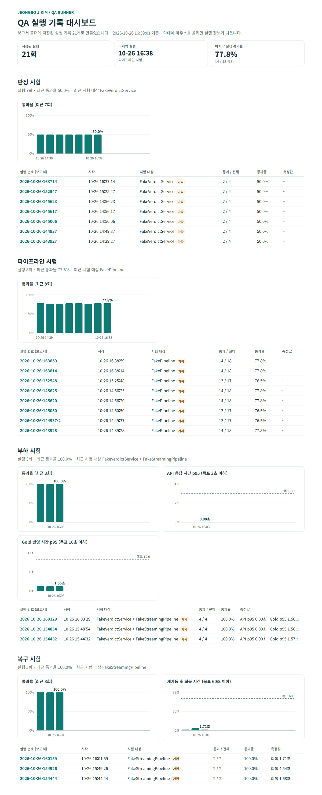

# 티켓가드 자동화 QA

> **처음 쓰는 팀원이라면 [설치·사용 안내](docs/install-and-use.md)부터 보세요.** 설치 방법 고르기, 첫 시험, 결과 읽는 법, 내 API 시험하기, 문제 해결까지 순서대로 정리했어요.

> **매크로 봇(트래픽 생성기) 작업은 [매크로 봇 작업 계획](#macro-bot-plan)에 정리했어요.** 브랜치·작업 폴더, 봇 종류, 구현 순서와 완료 기준, QA 프로그램과 연결하는 방법을 담았어요.

티켓가드(실시간 매크로 탐지 예매 시스템)가 **사람과 봇을 정확하게 판정하고, 행동 이벤트를 빠짐없이 처리하고, 멈췄다가도 회복하는지**를 자동으로 확인하는 QA 도구입니다. 사람인지 봇인지 정답을 아는 세션과 이벤트를 파일에 적어 두면, 프로그램이 입력을 시험 대상에 넣고 돌아온 결과를 정답과 비교해 채점하고 보고서로 남깁니다.

> 2026-11-02에 주제를 정보지킴(스미싱 판정)에서 티켓가드로 바꿨습니다. 채점 엔진·보고서·데스크탑 앱 구조는 그대로 두고, 시험 사례·판정 값·연결 형식·가짜 서버를 티켓가드 [연결 계약](../docs/contract.md)에 맞게 바꿨습니다.

같은 채점 엔진을 두 가지 방법으로 씁니다.

| 방법 | 누가 쓰나 | 무엇 |
|---|---|---|
| **데스크탑 앱** (`src/QaRunner.Desktop`) | 팀원 누구나 | 버튼으로 시험을 고르고 결과를 화면에서 바로 보는 Windows 앱 |
| **콘솔 프로그램** (`src/QaRunner`) | QA 담당, CI | 명령어로 시험을 돌리고 종료 코드로 성공·실패를 알림. 실제 Kafka·MongoDB·Spark 시험도 여기서 |

**목차**
[한눈에 보기](#한눈에-보기) ·
[진행 상황](#진행-상황) ·
[데스크탑 앱](#데스크탑-앱) ·
[팀원이 쓰는 방법](#팀원이-쓰는-방법) ·
[콘솔 프로그램](#콘솔-프로그램) ·
[시험 흐름](#시험-흐름) ·
[부하·복구 시험 기준](#부하복구-시험-기준) ·
[QA 도구 점검](#qa-도구-점검) ·
[가짜 예매·판정 서버 (앱)](#가짜-예매판정-서버-앱-영역) ·
[매크로 봇 작업 계획](#macro-bot-plan) ·
[실제 시스템에 연결하기](#실제-시스템에-연결하기) ·
[시험 케이스 작성법](#시험-케이스-작성법) ·
[보고서와 대시보드](#보고서와-대시보드) ·
[자동 검사 (CI)](#자동-검사-github-actions) ·
[AI 사례·팀 공유 스켈레톤](#ai-사례팀-공유-스켈레톤) ·
[폴더 구조](#폴더-구조) ·
[확장 방법](#확장-방법)

---

## 한눈에 보기

| 질문 | 답 |
|---|---|
| **왜 만드나** | 기획서의 핵심인 "결제 전에 몇 초 안에 판정하고, 데이터 처리가 정확하다"를 숫자로 증명하기 위해서입니다. 정답을 아는 봇·사람 세션, 중복 3회·역순·30초 지연·초당 5건 × 5분·Spark 30초 중단 같은 조건은 사람이 손으로 정확히 재현할 수 없고, 코드를 고칠 때마다 다시 확인해야 합니다. |
| **어떻게 하나** | ① 입력을 넣고 → ② 정답을 따로 계산하고 → ③ 시스템이 낸 실제 값을 꺼내 → ④ 비교해서 보고서로 남깁니다. 정답(사람인지 봇인지)은 시스템에 보내지 않고 QA 안에만 두므로, 시스템이 틀려도 정답은 오염되지 않습니다. |
| **무엇이 남나** | 실행 번호별 HTML·JSON 보고서, 통과율·p95·회복 시간 추이 대시보드, CI의 ✔/✘, 종료 코드(0 통과, 1 실패, 2 준비 오류) |
| **왜 C#인가** | HTTP·Kafka·MongoDB·JSON을 공식 라이브러리로 바로 쓸 수 있고, Python으로 만든 시스템과 언어가 달라 정답 계산이 자연스럽게 분리됩니다. 부하가 초당 5건 수준이라 C++의 속도는 필요하지 않습니다. |

시험은 무엇을 점검하는지에 따라 세 영역으로 나뉩니다. 보고서·대시보드·데스크탑 앱 모두 이 영역으로 묶어 보여 줍니다.

| 영역 | 시험 | 넣는 것 | 비교하는 것 |
|---|---|---|---|
| **서비스** | 판정 시험 (`verdict`) | 사람·봇 세션의 행동 (대기열 진입·좌석 클릭·점유·결제) | 판정 묶음 (사람은 정상·관찰, 봇은 추가 확인·보류), 봇 탐지율·사람 오탐률 |
| | 파이프라인 시험 (`pipeline`) | 행동 이벤트 + 중복·역순·지연 조건 | Bronze 보관 건수, Silver 고유 건수, 격리 건수, Gold 60초 구간 집계 |
| | 부하 시험 (`load`) | 세션 판정 요청 동시 반복 + 이벤트를 초당 N건씩 계속 | 판정까지 걸린 시간 p95(API 응답 시간 p95), 오류율, Gold 반영 시간 p95, 적체 |
| | 복구 시험 (`recovery`) | 이벤트를 계속 보내면서 처리를 멈췄다 재가동 | 재가동 후 회복 시간, 최종 집계 일치 |
| **앱** | 가짜 예매·판정 서버 (`mockapi`) | 앱이 백엔드 대신 이 서버에 보낸 예매·이벤트 요청. 서버는 추가 확인·보류·매진·판정 지연·오류 등을 골라 돌려줌 | 요청이 계약 3~5장 형식(경로·방식·JSON 필드)과 같은지. 추가 확인·오류 화면은 A가 앱에서 확인 |
| **QA 도구** | QA 도구 점검 (`selfcheck`) | 답을 이미 아는 입력 12가지 (코드에 고정) | 채점기가 틀린 결과를 잡아내는지, 정답 계산·p95·탐지율·보고서 저장이 맞는지 |

## 진행 상황

| 단계 | 내용 | 상태 |
|---|---|---|
| ① 스켈레톤 | 사례 파일 → 연습용 판정기 → 채점 → 콘솔 출력·종료 코드 | 완료 |
| ② 결과 저장·HTML 보고서 | 실행 번호별 JSON·HTML 보고서 저장 | 완료 |
| ③ 실제 API 연결 | 계약 초안대로 수집 API로 세션 행동을 보내고 판정 조회 API를 읽는 코드 완료 (`--api-url`). B의 백엔드가 나오면 실제로 확인 | 연결 대기 |
| ④ 파이프라인 시험 | 가짜 파이프라인으로 동작 확인. Kafka 발행·MongoDB 읽기 코드 완료 (`--kafka`, `--mongo`) | 연결 대기 |
| ⑤ 부하·복구 시험 | 가짜 파이프라인으로 동작 확인. Spark 컨테이너 중단·재가동 코드 완료 (`--spark-container`) | 연결 대기 |
| ⑥ 자동 실행·CI | GitHub Actions에서 푸시마다 빌드·테스트·시험 실행. docker-compose 서비스는 인프라가 생긴 뒤 | 일부 완료 |
| ⑦ 실행 기록 대시보드 | 실행할 때마다 `reports/dashboard.html`을 다시 만들어 추이를 표시 | 완료 |
| 데스크탑 앱 | 홈·여정 안내·조건 시트·결과·기록·관리 화면을 갖춘 Windows 앱 | 완료 |
| 시험 영역 | 서비스 · 앱 · QA 도구로 시험을 묶음. QA 도구 점검 12가지, CI에서 항상 통과해야 함 | 완료 |
| 티켓가드 전환 | 세션 사례(사람·봇 A~D), 판정 네 단계와 묶음 채점, 탐지율·오탐률, 행동 이벤트 형식, `ticket-events`·`ticketguard` 기본값 | 완료 (2026-11-02) |
| 앱 영역 ① 가짜 예매·판정 서버 | 예매·수집·판정 조회 API를 흉내 내는 서버(응답 방식 16가지)와 요청 계약 채점. 데스크탑 앱 홈 › 앱 카드, 콘솔 `--suite mockapi` | 완료 (A의 앱 연결 대기) |
| 매크로 봇 (트래픽 생성기) | Locust(가상 사람·봇 A·B·D)·Playwright(봇 C)로 프론트의 Django 예매 사이트에 실제 트래픽을 보내고 정답 표를 QA 쪽에 남김. 작업 방법은 [매크로 봇 작업 계획](#macro-bot-plan) | 진행 중 (설계 완료, 2026-11-02 구현 시작) |
| 탐지 평가 | 재생 시험(S3 기록을 원래 속도로 다시 흘림)·새 유형 봇 평가·사람 테스트 표본 관리 (기획서 4.6·4.7) | 계획 (3~4주 차 이후) |
| 앱 영역 ②③ | 앱 계약 시험(Jest 결과 수집), 화면 흐름 시험(Maestro 등) | 계획 |
| AI 사례·팀 공유 | 예제 세션 → 채점 → 로컬 보고서 → 공유 API → 팀 기록 조회 뼈대. Runpod(새 유형 봇 시나리오)·EC2 연결 전 | 스켈레톤 |

- **연결 대기:** ③④⑤는 연습용 대상으로 다 돌아가고, 실제 시스템에 붙이는 코드도 준비되어 있습니다. 팀원 작업이 나오면 옵션(`--api-url`, `--kafka`, `--mongo`)만 넣어 확인합니다.
- **구조:** 채점기·정답 계산기·보고서는 바뀌지 않고, 시험 대상만 가짜에서 실제로 바꿔 끼웁니다.

---

## 데스크탑 앱

명령어 없이 화면에서 시험을 고르고 결과를 보는 Windows 앱입니다. 콘솔 프로그램과 같은 실행 절차(`QaRunService`)를 쓰므로 결과와 보고서도 똑같습니다.

```bash
dotnet run --project src/QaRunner.Desktop
```

### 처음 5분 따라 하기

앱을 켜면 **홈**이 열리고, 홈 위쪽의 **처음 사용하는 순서**(여정 지도)가 지금 할 일을 알려 줍니다. 아래 순서대로 하면 단계가 저절로 체크됩니다.

1. 홈의 **다음 할 일** 배너에서 **빠른 점검 고르기**를 누릅니다. ‘빠른 점검’ 카드를 눌러도 됩니다.
2. 오른쪽에 **조건 시트**가 열립니다. 시험 대상이 **연습용 대상**인지 확인하고 **시험 시작하기**를 누릅니다. 약 10초 뒤 **시험** 화면에 결과가 나옵니다.
3. 다른 값이 나온 항목을 골라 **예상 정답·기준**과 **실제 결과**를 비교하고, **보고서 열기**로 HTML 보고서를 엽니다.
4. **기록** 메뉴에서 지난 실행을 골라 다시 열어 봅니다.

내 백엔드를 시험하려면 조건 시트에서 **내 판정 API**를 고르고 주소(예: `http://localhost:8000`)를 넣습니다. 입력칸 아래에 실제로 보낼 주소(`/events`, `/verdicts/세션`)가 나오고, 주소가 비었거나 잘못되면(끝에 `/events`까지 넣은 경우 포함) 실행하지 않고 시트 안에서 알려 줍니다.

모르는 버튼이나 입력칸에 마우스를 잠시 올리거나 Tab으로 선택하면 말풍선이 나옵니다. 왼쪽 아래 **사용 안내** 또는 **F1**에서 시작 순서와 기능 안내를 볼 수 있습니다.

### 화면 구성

왼쪽 메뉴는 **홈 · 시험 · 기록 · 관리** 네 개입니다. 기록과 관리는 위쪽 탭으로 나뉩니다. 제목 표시줄에 "티켓가드 QA / 메뉴 / 탭"으로 지금 위치가 나오고, 아래 상태 표시줄에 그 화면에서 할 일이 나옵니다.

| 메뉴 | 탭 | 하는 일 |
|---|---|---|
| 홈 | — | 인사말 · 처음 사용하는 순서(여정 지도 4단계) · 지금 단계에 맞춘 **다음 할 일** 배너 · 통과율/이번 주 실행/다시 볼 항목 요약 · **서비스 · 앱 · QA 도구** 영역 카드(설명·시험 수·담당 표시)와 그 아래 시험 카드(카드마다 최근 결과. 앱 영역은 가짜 예매·판정 서버 켜기·받은 요청 목록) · 최근 실행 3건 |
| 시험 | — | 진행 상태와 결과(완료 카드 · 요약 숫자 · 항목별 결과 · 선택한 항목의 예상과 실제 비교) · 조건 바꾸기 · 보고서 열기 · 전체 추이 |
| 기록 | 내 기록 | 저장한 기록 수·평균 통과율·마지막 실행 요약 · 영역이 표시된 실행 목록에서 고르면 시험 화면에서 그때 결과를 다시 엶 |
| 기록 | 팀 공유 | 실행자·환경·버전·공유 방식 한 줄 · 왼쪽 실행 목록 · 오른쪽 사례별 비교 |
| 관리 | 시험 세션 | 왼쪽 세션 목록(행위자·행동) · 오른쪽 행동 흐름·예상 정답·정답 상태·정답 근거 |
| 관리 | AI 세션 | Runpod 연결 자리 (준비 중, 새 유형 봇 시나리오 생성). 지금은 예제 세션 4개로 연습 |
| 관리 | 설정 | 사례 파일 · API 주소 · 보고서 폴더 · 연결 상태 · 처음 사용하는 순서 다시 보기. 바꾼 값은 지금 켜 둔 앱에서만 적용 |

**오른쪽 조건 시트**는 홈의 시험 카드, 시험 화면의 **조건 바꾸기**, 결과가 없을 때의 **시험 고르기**로 엽니다. 시험 종류·시험 대상(연습용/내 판정 API)·사례 파일·시간·건수·보고서 위치를 확인하고, 걸리는 시간을 본 뒤 **시험 시작하기**를 누릅니다. X나 바깥을 누르면 닫힙니다.

- 처음 사용하는 순서는 저장하지 않습니다. 앱을 켤 때 이미 실행 기록이 있으면 앞의 두 단계(고르기·실행하기)는 끝낸 것으로 표시합니다. **관리 › 설정 › 처음부터 다시**로 되돌릴 수 있습니다.
- 부하·복구 시험은 화면에서 바로 보여 주기 좋게 기본 시간을 짧게 잡았습니다(부하 30초, 복구 60초·15초 중단). 시트에서 숫자를 바꾸면 실행안 기준(부하 300초, 복구 120초·30초 중단)으로도 돌릴 수 있습니다.
- 데스크탑 앱에서는 백엔드 API 주소만 넣을 수 있습니다. 실제 Kafka·MongoDB·Spark 시험은 [콘솔 프로그램](#콘솔-프로그램)으로 돌립니다.
- 입력 경로와 보고서 폴더는 `qa/` 폴더 기준입니다. 실행 파일을 어디서 열어도 `qa/` 폴더를 찾아 기준으로 삼습니다.

### 결과 읽는 법

| 표시 | 뜻 |
|---|---|
| **통과** | 예상 정답과 같거나 측정 기준을 만족 |
| **불일치** | 예상과 다른 값을 받음 |
| **기준 미달** | 측정한 값이 기준(예: p95 3초)을 넘음 |
| **응답 없음** | 시험 대상이 결과를 돌려주지 못함 (연결 실패, 시간 초과 등). 판정이 틀린 것과 구분 |

- **연습용 대상**에는 일부러 틀리는 규칙이 들어 있습니다(연습용 판정기는 대기열 진입이 0.3초보다 빠른지만 보고, 가짜 파이프라인은 격리를 하지 않음). 그래서 사람 속도로 들어오는 봇 C·D를 놓칩니다. 채점기가 틀린 결과를 잡아내는지 보는 용도이며, 완료 카드에 "연습용 대상" 표시가 붙습니다. 판정 API와 연습용 파이프라인을 섞어 쓴 경우에만 노란 안내를 따로 띄웁니다.
- 판정은 **묶음으로 채점**합니다. 사람 세션이 "관찰"이어도, 봇 세션이 "보류"여도 통과입니다. 판정 결과 뒤에는 **봇 탐지율(A·B·D / C / 새 유형)**과 **사람 오탐률** 항목이 붙고, 사람 세션이 300개보다 적으면 참고값이라고 표시합니다.
- 아직 사람이 검토하지 않은 정답(예제·AI 세션)과 비교한 기록은 "정답 검토 전"으로 따로 표시합니다.

시험 중에는 결과 자리에 **진행 카드**가 나옵니다. 어떤 시험을 무엇을 하며 돌리는지, 지난 시간, 부하·복구 시험은 보내기까지 남은 시간과 진행 막대, 지금 단계(입력 보내기 → 결과 모으기 → 채점·보고서 저장)를 보여 주고, 상태 표시줄은 민트 띠로 바뀝니다.

시험이 끝나면 세 곳에서 알려 줍니다.

| 위치 | 모양 |
|---|---|
| 결과 맨 위 **완료 카드** | 민트 그라데이션 카드에 "시험이 끝났어요", 요약, **보고서 열기·다시 실행** 버튼. 연습용 대상이면 "연습용 대상" 표시를 붙임. 기록에서 다시 연 결과는 "지난 실행 결과예요"로 나옴 |
| 맨 아래 **상태 표시줄** | 모두 통과면 초록, 다시 볼 항목이 있으면 주황, 응답 없음이나 오류면 빨강 띠로 바뀌고 **보고서 열기·폴더 열기** 버튼이 붙음. 다른 메뉴로 가면 평소 모양으로 돌아옴 |
| 결과 표의 **다음 행동 말풍선** | 첫 번째 줄을 가리키며 무엇을 누를지 알려 줌. 앱을 켠 뒤 처음 3번만 나오고, 표를 누르거나 **알겠어요**를 누르면 닫힘. **처음부터 다시**를 누르면 다시 3번 나옴 |

### 창과 화면 크기

- 오른쪽 위 **최소화·최대화/이전 크기로·닫기** 버튼을 씁니다. 제목 표시줄을 드래그하면 이동, 더블클릭하면 최대화/복원합니다. 가장자리·모서리·오른쪽 아래 손잡이로 크기를 조절합니다.
- 기본 창은 1120 × 740이며, 시작할 때 모니터 작업 영역과 Windows DPI에 맞춰 크기·위치를 보정합니다. 창 크기에 따라 본문 배율이 75~100%로 자동 조정되고 오른쪽 아래에 표시됩니다. 더 작은 창은 스크롤합니다.
- Windows 전용입니다(WPF). 맥·리눅스에서는 콘솔 프로그램을 씁니다.

### 화면 디자인 규칙

[WPF UI](https://github.com/lepoco/wpfui) 4.3.0의 밝은(Light) 컨트롤에 **민트 프레시** 색을 입혔습니다. 화면을 고치거나 추가할 때는 `DesktopTheme.xaml`의 값을 씁니다.

| 항목 | 규칙 |
|---|---|
| 색 | 강조 청록 `#0D9488` 한 가지(기본 버튼·선택·링크), 홈 배너와 결과 완료 카드만 청록→초록 그라데이션. 본문 바탕 `#F3F8F7`, 메뉴·카드 `#FFFFFF`, 선 `#DDEDEA`, 선택 `#E6FAF6`. 글자 `#0F2A27`, 보조 글자 `#5B706C`. 결과 색은 통과 `#15803D` · 실패 `#BE123C` · 주의 `#B45309`로 테마와 관계없이 고정 |
| 카드 | 홈·결과는 둥근 모서리 20 + 옅은 그림자(`SoftCard`), 시험 카드는 `SuiteCard`(마우스를 올리면 청록 테두리), 홈의 영역 카드는 `AreaCard`(아이콘 · 이름 · 한 줄 설명 · 시험 수와 담당, 고르면 민트 바탕 · 청록 테두리 · 체크). 설정 한 줄은 `CardControl`(`SettingCard`) |
| 버튼 | 화면마다 주요 동작 하나만 `PrimaryButton`. 나머지는 `SecondaryButton`(높이 32)·`TextButton`. 배너 위는 흰 알약 `PillButton`, 시트의 시작 버튼은 높이 48 알약 |
| 아이콘·알림 | WPF UI `SymbolIcon`(Fluent System Icons), 고르면 채운 아이콘. 안내·경고·오류는 `InfoBar`. 시험 중에는 진행 카드와 민트 띠, 시험 완료는 완료 카드와 상태 표시줄 색 띠(통과 초록 · 다시 볼 항목 주황 · 오류 빨강)로 알림 |
| 간격·글자 | 간격 4·8·12·16·20·24·32, 글자 12·13·14·16·20·22·26. 본문 여백 좌우 32, 왼쪽 메뉴 폭 212 |
| 목록 | 카드 안에 테두리 없이 행 높이 40. 건수·시간은 `NumberCell`로 오른쪽 정렬, 긴 값은 `TrimmedCell`로 말줄임 + 말풍선, 빈 목록은 `EmptyListText` 안내 |
| 상태 표시 | 고른 항목은 옅은 청록 바탕 + 왼쪽 강조선(`SelectableListItem`). 짧은 상태는 `StatusBadge`(확인 완료 초록, 확인 전 노랑) |
| 배경 이미지 | 홈 배너는 `Assets/Backgrounds/`의 압축 이미지 20개 중 한 장을 무작위로 골라 그 한 장만 읽고, 위에 그라데이션을 덮음. 출처와 라이선스는 `THIRD-PARTY-NOTICES.txt` |
| 앱 아이콘 | 방패 돋보기(어두운 청록 바탕 `#0F2A27`, 방패 `#2DD4BF`, 흰 돋보기). exe·바로 가기·작업 표시줄·창에 `Assets/AppIcon.ico`(16~256px 9가지 크기), 왼쪽 메뉴 로고에 `Assets/AppIcon.png`(128px). 원본은 `Assets/AppIcon.svg`이고, 바꿀 때는 이 그림을 기준으로 두 파일을 다시 만듦 |

### 화면 캡처와 UI 점검

README·발표 자료용 화면이 필요하면 캡처 모드로 실행합니다. 창을 화면 밖에 띄워 시험을 한 번 돌리고 PNG를 저장한 뒤 바로 꺼집니다. 캡처 경로는 저장소 밖으로 지정하세요.

```bash
dotnet run --project src/QaRunner.Desktop -- --capture C:/Temp/screen.png --suite load --page run
```

`--page`에는 `home`, `run`, `reports`, `team`, `cases`, `ai`, `settings`를 쓸 수 있습니다(생략하면 `run`).

`--ui-smoke`는 실제 화면 컨트롤을 눌러 보며 98가지를 점검하고, 단계별 PNG와 `ui-smoke.json`을 저장합니다. 메뉴·탭 이동, 홈 영역 카드(서비스·앱·QA 도구), 홈 카드 → 조건 시트, 주소 오류 안내(`/events`까지 넣은 주소 포함), 다섯 종류 시험(QA 도구 점검 포함) 실행·보고서 저장, 가짜 예매·판정 서버 켜기·실제 HTTP 예매 요청·받은 요청 목록·끄고 채점, 시험 중 진행 카드, 완료 카드·상태 표시줄 색 띠·다음 행동 말풍선, 중복 실행 차단, 여정 단계 체크, 팀 공유, 기록 다시 열기, 최소 창 크기, Windows용 Kafka 라이브러리 로드까지 확인합니다. 보고서는 지정한 폴더 안의 `reports/`에만 남깁니다.

```bash
dotnet run --project src/QaRunner.Desktop -- --ui-smoke C:/Temp/qa-ui-review
```

---

## 팀원이 쓰는 방법

설치부터 첫 시험까지 따라 하는 자세한 설명은 [설치·사용 안내](docs/install-and-use.md)에 있습니다. 이 절은 QA 담당이 배포 방식을 관리할 때 보는 요약입니다.

| 하고 싶은 것 | 방법 | 필요한 것 |
|---|---|---|
| 결과만 보기 | 웹 대시보드 **https://seoloo.github.io/MLO2_3rd_Project/** 열기 | 없음 (브라우저만) |
| 배포 파일로 시험 돌리기 | `QA-windows-x64.zip`을 풀고 `QaRunner.Desktop.exe` 실행 | Windows x64, .NET 10 Desktop Runtime(x64) |
| 직접 시험 돌리기 (예: 내 API 시험) | `qa/run-qa-desktop.cmd` 더블클릭 | 처음 한 번: .NET 10 SDK 설치, 저장소 clone |

### 결과만 보기: 웹 대시보드

- 기본 브랜치(`main`)에 푸시할 때마다 GitHub Actions가 네 가지 시험을 돌리고, 실행 기록을 `qa-history` 브랜치에 쌓은 뒤 대시보드를 GitHub Pages에 올립니다.
- 대시보드의 실행 번호를 누르면 그 실행의 상세 보고서가 열립니다.
- 웹 대시보드는 CI 기록만 보여 줍니다. 각자 PC에서 돌린 기록은 각자의 `qa/reports/dashboard.html`에 쌓입니다.

### 배포 파일로 실행하기

QA 담당자가 `qa/publish-qa-desktop.cmd`를 더블클릭하면 `qa/dist/QA-windows-x64.zip`이 만들어집니다. .NET 10 SDK가 필요하며, 이 명령은 Git에서 코드를 받거나 푸시하지 않습니다.

1. ZIP을 [GitHub Releases](https://github.com/seoloo/MLO2_3rd_Project/releases)에 새 릴리스로 올려 링크를 공유합니다. 태그는 `qa-v<주>.<부>.<수>` 형식(예: `qa-v1.0.0`)으로 붙이고, 바뀐 점을 릴리스 설명에 적습니다. 메신저로 ZIP을 직접 보내면 누가 어느 버전을 쓰는지 알기 어렵습니다.
2. 팀원은 ZIP을 쓸 수 있는 폴더에 **전부 압축 해제**합니다. ZIP에는 실행 파일, `cases` 폴더, 라이선스 안내, [설치·사용 안내](docs/install-and-use.md)가 들어 있습니다.
3. 처음 한 번 .NET 10 Desktop Runtime(x64)을 설치하고 `QaRunner.Desktop.exe`를 실행합니다. SDK는 필요하지 않습니다.

```powershell
winget install Microsoft.DotNet.DesktopRuntime.10
```

실행 기록은 압축을 푼 폴더의 `reports/`에 저장됩니다. 배포 파일에는 팀원 간 원격 동기화 기능이 없습니다.

2026-10-29 v1.1.0 로컬 Release 빌드 기준 크기입니다. 기능이 늘어나면 달라집니다.

| 구성 | 크기 |
|---|---:|
| JPEG 배경 20개 합계 (실행 파일에 포함) | 3.23 MiB |
| Windows x64 실행 파일 | 27.59 MiB |
| 배포 폴더 전체 (실행 파일 · cases · 라이선스 안내) | 27.60 MiB |
| 전달용 ZIP (설치·사용 안내 포함) | 12.74 MiB |

- 배포본은 Windows x64만 묶고 .NET 실행 환경은 따로 설치합니다. 다른 운영체제용 바이너리는 소스 의존성을 유지한 채 이 배포본에서만 뺍니다.
- Kafka·MongoDB 라이브러리, Spark 연결 코드, Runpod·EC2 확장 구조는 삭제하지 않습니다. Windows용 Kafka 네이티브 라이브러리는 실행 파일에 포함하고, UI 점검에서 실제 로드를 확인합니다.
- WPF와 이후 확장을 위해 트리밍은 쓰지 않습니다.
- `dist/`·빌드 결과·ZIP은 Git에 올리지 않습니다. 앱이 실제로 쓰는 압축 배경 이미지는 소스에 포함합니다.

### 직접 돌리기: run-qa-desktop.cmd

처음 한 번 .NET 10 SDK를 설치하고 저장소를 받습니다.

```bash
winget install Microsoft.DotNet.SDK.10
```

```bash
git clone https://github.com/seoloo/MLO2_3rd_Project.git
```

그다음부터는 탐색기에서 `qa/run-qa-desktop.cmd`를 **더블클릭**합니다. 매번 ① 최신 코드 받기(`git pull`, 고치던 파일이 있으면 안내만 하고 계속) → ② 데스크탑 앱 빌드 → ③ 앱 실행 순서로 동작합니다. 앱이 이미 켜져 있으면 빌드할 수 없으니 먼저 닫으라고 안내합니다. 빌드가 실패하면 오류를 보여 주고 멈추므로, 그 내용을 QA 담당에게 알려 주세요.

---

## 콘솔 프로그램

### 설치

```bash
winget install Microsoft.DotNet.SDK.10
```

터미널을 새로 열고 버전이 `10.0.`으로 시작하는지 확인합니다.

```bash
dotnet --version
```

### 실행

명령은 모두 `qa/` 폴더에서 실행합니다.

```bash
dotnet run --project src/QaRunner
```

```bash
dotnet run --project src/QaRunner -- --suite pipeline
```

지금은 일부러 엉성하게 만든 연습용 대상으로 돌기 때문에 실패가 나옵니다. 판정 시험은 세션 7개 중 봇 C·D 2개와 탐지율 2개(10개 중 4개), 파이프라인 시험은 5분 초과 도착·같은 ID 상충 관련 4개가 실패합니다. 채점기가 틀린 결과를 잡아내는지 보는 것입니다.

부하·복구 시험은 실행안 기준으로 기본 5분(부하), 2분(복구)이 걸립니다. 짧게 확인하려면 시간을 줄입니다.

```bash
dotnet run --project src/QaRunner -- --suite load --duration 10
```

```bash
dotnet run --project src/QaRunner -- --suite recovery --duration 20 --stop-seconds 5
```

QA 러너 자체의 테스트:

```bash
dotnet test
```

### 옵션

옵션은 `--` 뒤에 붙입니다. 생략하면 기본값을 씁니다.

| 옵션 | 뜻 | 기본값 |
|---|---|---|
| `--suite` | 시험 종류. `verdict`, `pipeline`, `load`, `recovery`, `selfcheck`, `mockapi` | `verdict` |
| `--cases` | 판정·부하 시험은 세션 사례 파일, 파이프라인 시험은 시나리오 폴더 (복구 시험은 안 씀) | `cases/sessions.json` / `cases/pipeline` |
| `--reports` | 보고서를 저장할 폴더 | `reports` |
| `--api-url` | 백엔드 API 주소. `http://` 또는 `https://`로 시작. QA가 뒤에 `/events`·`/verdicts`를 붙임 (판정·부하 시험) | 없음 (연습용 판정기) |
| `--duration` | 부하·복구 시험에서 이벤트를 보내는 시간(초). 가짜 예매·판정 서버는 켜 둘 시간 | 부하 300 / 복구 120 / 가짜 서버는 직접 끌 때까지 |
| `--rate` | 부하·복구 시험에서 1초에 보내는 이벤트 수 | 5 |
| `--stop-seconds` | 복구 시험에서 처리를 멈춰 두는 시간(초). 전체 시간의 1/4 지점에서 멈춤 | 30 |
| `--kafka` | 실제 Kafka 주소. `--mongo`와 함께 주면 실제 파이프라인을 대상으로 시험 | 없음 (가짜 파이프라인) |
| `--mongo` | 실제 MongoDB 연결 문자열. 비밀번호가 들어 있으면 셸 기록·CI 로그에 남으니 CI에서는 Secrets로 넣는다 (보고서에는 기록하지 않음, [AWS·EC2 보안 체크리스트](../infra/README.md#awsec2-보안-체크리스트)) | 없음 |
| `--kafka-topic` | 이벤트를 넣을 토픽 | `ticket-events` |
| `--mongo-db` | 메달리온 컬렉션이 있는 분석 DB | `ticketguard` |
| `--port` | 가짜 예매·판정 서버를 열 포트 | 8000 |
| `--scenario` | 가짜 예매·판정 서버의 처음 응답 방식. `auto`, `normal`, `watch`, `verify`, `hold`, `queue`, `taken`, `soldout`, `expired`, `delayed`, `slow`, `timeout`, `broken`, `400`, `500`, `503` | `auto` |
| `--allow-lan` | 가짜 예매·판정 서버를 같은 Wi-Fi의 다른 기기에도 엶 (값 없이 씀) | 이 PC에서만 |
| `--spark-container` | 복구 시험에서 멈췄다 켤 Spark 판정 작업 컨테이너 | `spark` |

### 종료 코드

CI가 성공·실패를 판단할 때 씁니다.

| 종료 코드 | 뜻 |
|---|---|
| `0` | 모든 항목 통과 |
| `1` | 실패한 항목이 하나 이상 있음 (응답 없음 포함) |
| `2` | 채점을 시작하지 못함 (옵션·측정 숫자 오류, 사례 파일·시나리오 폴더 없음/형식 오류, API 주소 오류, 가짜 서버 포트 사용 중, 실제 MongoDB를 읽지 못함) |

---

## 시험 흐름

### 판정 시험

```
세션 사례 파일 ──(행동만: POST /events)──▶ 판정 대상 ──(GET /verdicts/세션)──▶ 묶음 채점 ──▶ 사례별 결과 + 탐지율·오탐률
      └──────────────────(행위자·정답)───────────────────────────────┘
```

- 사례의 시각은 "예매 오픈 뒤 몇 밀리초"라서, 보낼 때는 마지막 행동이 1초 전에 끝난 것으로 맞춰 실제 시각으로 바꿉니다. 세션 해시는 `qa-{실행 번호}-{사례 번호}`라 실행끼리 겹치지 않습니다.
- 봇 D처럼 `parallelSessions`가 2 이상이면 같은 기기 해시로 세션을 여러 개 보내고 첫 세션의 판정을 채점합니다.
- 판정 조회는 0.5초마다 하고, 10초 안에 나오지 않으면 응답 없음(시스템 실패)입니다.

### 파이프라인 시험

```
시나리오 ──▶ 전송 계획 ──(이벤트)──▶ 파이프라인 ──(실제 건수)──▶ 채점 ──▶ 결과
               └──▶ 정답 계산기 ──(정답 건수)───────────────────┘
```

### 부하·복구 시험

```
일정한 속도로 보내기 ──(이벤트)──▶ 파이프라인 ──▶ Gold
        │                                          │ 0.5초마다 건수 확인
        └──(보낸 시각)──▶ 반영 추적기 ◀──(늘어난 건수)─┘ → 반영 시간 p95, 회복 시간
```

- 정답은 시험 대상을 거치지 않습니다. 판정 시험은 QA 트랙이 사례 파일에 적어 둔 정답을, 파이프라인 시험은 정답 계산기가 "보낸 기록"만 보고 계산한 정답을 씁니다.
- 시험 대상은 바꿔 끼울 수 있습니다. 지금은 연습용(`FakeVerdictService`, `FakePipeline`, `FakeStreamingPipeline`)으로 돌고, 실제 백엔드·파이프라인이 준비되면 그 부분만 바꿉니다.

## 부하·복구 시험 기준

실행안의 초기 목표를 그대로 잽니다. 목표는 실측 전 기준이라, 미달하면 조건·원인과 함께 그대로 남깁니다.

| 시험 | 확인 항목 | 목표 | 재는 방법 |
|---|---|---|---|
| 부하 | API 응답 시간 p95 | 3초 이하 | 가상 사용자 5명이 세션 행동을 보내고 판정을 받는 것을 동시에 반복 (판정까지 걸린 시간, 끝나면 0.2초 쉬고 다음 세션) |
| 부하 | API 오류율 | 0% | 위 요청 중 연결 실패·오류 응답·시간 초과 비율 |
| 부하 | Gold 반영 시간 p95 | 10초 이하 | 이벤트를 보낸 시각부터 Gold 건수에 잡힌 시각까지 |
| 부하 | Gold 반영 건수 (적체 없음) | 보낸 건수와 같음 | 보내기가 끝나고 최대 60초 기다린 뒤 Gold에 반영된 건수 |
| 복구 | 재가동 후 회복 시간 | 60초 이하 | 재가동한 시각부터, 그때까지 보낸 이벤트가 모두 Gold에 반영된 시각까지 |
| 복구 | 최종 Gold 반영 건수 (집계 일치) | 보낸 건수와 같음 | 보내기가 끝나고 최대 60초 기다린 뒤 Gold에 반영된 건수 |

- **p95**는 "100건 중 95번째로 느린 건의 시간"입니다. 95%가 이 시간 안에 끝났다는 뜻이라 평균보다 체감 속도를 잘 보여 줍니다.
- **Gold 반영 시간은 근삿값입니다.** 0.5초마다 Gold 건수를 읽고, 늘어난 만큼 먼저 보낸 이벤트부터 반영된 것으로 봅니다. 실제 MongoDB에서도 같은 방식으로 잴 수 있지만, 다른 데이터가 섞이면 안 되므로 시험 환경에서 돌려야 합니다.
- **지금은 가짜 파이프라인(`FakeStreamingPipeline`)으로 돕니다.** 받은 이벤트를 1초 뒤에 반영하고 1초에 최대 20건까지 처리하며, 멈추라고 하면 받기만 합니다. 측정 코드가 맞게 도는지는 확인할 수 있지만 수치 자체는 실제 성능이 아닙니다.

## QA 도구 점검

"QA가 틀리면 QA 결과도 믿을 수 없다"는 문제를 막으려고, QA 러너가 다른 시스템을 채점하기 전에 **답을 이미 아는 입력으로 자기 자신을 점검**합니다. 입력은 `SelfCheck/QaToolSelfChecker.cs` 안에 고정해 두어 사례 파일을 고쳐도 결과가 바뀌지 않고, 외부 연결 없이 1초 안에 끝납니다.

```bash
dotnet run --project src/QaRunner -- --suite selfcheck
```

| 번호 | 확인하는 것 | 넣는 것 → 기대하는 결과 |
|---|---|---|
| SC-01 | 판정 채점기 분류 | 같은 판정 · 같은 묶음 다른 단계(정상↔관찰) · 다른 묶음 · 응답 오류 각 1건 → 통과 2 · 불일치 1 · 응답 없음 1 |
| SC-02 | 결함 잡아내기 · 판정 | 진입 속도만 보는 연습용 판정기에 사람 속도로 들어온 봇 D(한 기기 세션 20개) → 불일치로 잡아냄 |
| SC-03 | 결함 잡아내기 · 파이프라인 | 격리를 하지 않는 연습용 파이프라인에 6분 늦은 이벤트 → 격리 건수 불일치로 잡아냄 |
| SC-04~06 | 정답 계산 (중복·늦은 도착·같은 ID 상충) | Bronze·Silver·격리 건수가 실행안 규칙과 같음 |
| SC-07 | 정답 계산 · Gold 60초 구간 | 00:10·00:50·01:10 이벤트 → 2개 구간 · 2건 / 1건 |
| SC-08 | p95 계산 | 1~100초 100건 → 95.00초 |
| SC-09 | 판정 코드 변환 | `NORMAL`·`WATCH`·`VERIFY`·`HOLD` → 정상·관찰·추가 확인·보류 |
| SC-10 | 보고서 저장 후 다시 읽기 | 임시 폴더에 저장한 실행 기록을 다시 읽어 건수·영역·HTML 내용이 같음 |
| SC-11 | 실행 번호 겹침 방지 | 같은 초의 보고서가 있으면 `-2`를 붙임 |
| SC-12 | 탐지율·오탐률 계산 | 봇 A 2개 중 1개 추가 확인, 사람 2개 중 1개 관찰, 봇 C 응답 없음 → 봇 A·B·D 50% · 사람 오탐 0% · 응답 없는 봇 C는 세지 않음 |

- 서비스 영역 시험과 달리 **항상 통과해야 합니다.** CI에서 하나라도 실패하면 검사가 실패합니다.
- 점검 코드에서 예외가 나면 그 항목만 "시스템 실패"로 남기고 나머지는 계속 돌립니다.
- QA 러너 단위 시험(`dotnet test`)과 화면 점검(`--ui-smoke`)은 개발자용 점검으로 따로 돌고, 데스크탑 앱 홈의 **QA 도구** 영역 카드에 함께 안내합니다.

## 가짜 예매·판정 서버 (앱 영역)

B의 백엔드가 나오기 전에도 A가 예매 화면과 추가 확인·오류 처리를 만들고 확인할 수 있게, QA 러너가 **예매 API·수집 API·판정 조회 API(계약 3~5장)를 흉내 내는 서버**를 띄웁니다. 앱은 API 주소만 바꾸면 되고, 서버는 받은 요청이 계약과 같은 형식인지 기록해 채점합니다. 팀원용 따라 하기는 [설치·사용 안내](docs/install-and-use.md#앱을-가짜-예매판정-서버에-붙이기-a)에 있습니다.

- **데스크탑 앱:** 홈 › **앱** 영역 카드 › 포트·응답 방식 고르기 › **서버 켜기** → 화면의 주소를 앱에 넣고 예매 진행 → 오른쪽 **받은 요청** 목록에 바로 표시 → **끄고 결과 보기**로 채점·보고서 저장. 켜 둔 채로 응답 방식을 바꿀 수 있습니다.
- **콘솔:** 끝낼 때는 Enter 또는 Ctrl+C. `--duration`을 주면 그 시간 뒤에 저절로 꺼집니다.

```bash
dotnet run --project src/QaRunner -- --suite mockapi
```

```bash
dotnet run --project src/QaRunner -- --suite mockapi --port 8010 --scenario verify --duration 300
```

| 앱을 띄운 곳 | 앱에 넣을 주소 |
|---|---|
| 웹 브라우저(Expo 웹), iOS 시뮬레이터 | `http://127.0.0.1:8000` 또는 `http://localhost:8000` |
| Android 에뮬레이터 | `http://10.0.2.2:8000` |
| USB로 연결한 Android | `adb reverse tcp:8000 tcp:8000` 후 `http://127.0.0.1:8000` |
| 같은 Wi-Fi의 실제 휴대폰(Expo Go) | 같은 Wi-Fi 허용(`--allow-lan`)을 켜고 화면에 나온 `http://192.168.x.x:8000` |

### 흉내 내는 API

| 요청 | 가짜 서버가 하는 일 |
|---|---|
| `POST /queue/enter` | 대기 번호(`queueToken`)와 순번. 보통은 바로 입장(0번) |
| `GET /queue/{queueToken}` | 지금 순번과 입장 여부(`admitted`) |
| `POST /seats/hold` | 5분 점유(`holdId`, `expiresAt`). 다른 세션이 점유한 좌석은 409, 팔린 좌석은 410 |
| `POST /payments` | 세션의 판정대로 `PAID` / `VERIFY_REQUIRED`(+`verifyId`) / `ON_HOLD`. 판정이 아직 없으면 2초 기다린 뒤 `VERIFY_REQUIRED` (계약 3장) |
| `POST /verifications/{verifyId}` | 코드 `123456`이면 결제 완료, 아니면 400 |
| `POST /events` | 행동 이벤트를 받아 202 `{ "accepted": n }`. 자동 판정의 재료가 됨 |
| `GET /verdicts/{sessionHash}` | 판정·점수·근거 규칙. 아직 없으면 404 |

### 응답 방식

서버 전체에 하나를 고르고, 요청 헤더 `X-Mock-Scenario: verify`나 주소 끝 `?mock=verify`를 붙이면 그 요청만 다른 응답을 받습니다. 값은 `--scenario` 값과 같습니다.

| 응답 방식 | 값 | 서버가 돌려주는 것 | 앱에서 확인할 것 |
|---|---|---|---|
| 자동 판정 (기본) | `auto` | 좌석 클릭 간격이 0.15초보다 짧으면 추가 확인, 화면 기록 없이 예매 API만 부르면 관찰, 나머지는 정상 | 예매 흐름 끝까지 · 이벤트 수집이 쌓이는지 |
| 항상 정상 · 관찰 | `normal` `watch` | 결제 바로 완료 (관찰은 판정 조회에만 `WATCH`) | 추가 확인 화면이 나오지 않음 · 상황판의 관찰 표시 |
| 항상 추가 확인 | `verify` | 결제 202 `VERIFY_REQUIRED`, 코드 `123456`만 통과 | 좌석을 유지한 채 본인 확인 · 틀린 코드 재입력 |
| 항상 보류 | `hold` | 결제 202 `ON_HOLD` | 실패처럼 보이지 않는 "운영자 검토 중" 안내, 단정하지 않는 표현 |
| 긴 대기열 | `queue` | 순번 1,2xx번에서 1초에 150명씩 줄어 약 8초 뒤 입장 | 순번이 줄어드는 표시, 입장하면 좌석 화면으로 |
| 이미 점유된 좌석 · 매진 | `taken` `soldout` | 좌석 점유 409 · 410 | 다른 좌석 고르기 · 매진 안내 |
| 점유 시간 끝남 | `expired` | 결제 404 | 좌석 선택으로 돌아가기, 남은 점유 시간 표시 |
| 판정 지연 | `delayed` | 12초 동안 판정 조회 404, 결제는 2초 기다린 뒤 추가 확인 | 판정이 늦어도 결제가 그냥 통과하지 않음, 상황판의 "판정 전" 구분 |
| 3초 · 12초 늦은 응답 | `slow` `timeout` | 모든 요청을 늦게 응답 (12초는 10초 제한 초과) | 로딩 표시와 중복 요청 방지 · 10초 뒤 오류와 다시 시도 |
| 깨진 응답 | `broken` | 중간에 잘린 JSON (200) | 앱이 멈추지 않는 오류 안내 |
| 잘못된 요청 400 · 서버 오류 500 · 일시 중단 503 | `400` `500` `503` | 해당 상태 코드와 `{ "error": "..." }` | 예매 결과처럼 보이지 않는 오류 안내, 고른 좌석을 잃지 않고 다시 시도 |

### 채점과 보고서

- 받은 요청 1건이 확인 항목 1개입니다. 계약 3~5장의 경로·요청 방식·`Content-Type: application/json`·필수 필드(이벤트는 4-1장 필드, 종류, `origin`, `source`, 시각 형식까지)와 같으면 통과입니다.
- 다르면 무엇이 다른지를 실제 값에 적고, 앱에는 404(경로) · 405(방식) · 400(본문)과 `{ "error": "..." }`로 답합니다.
- 서버를 켜 둔 동안 요청을 한 건도 받지 못하면 "앱 요청 받기" 항목이 실패합니다. 데스크탑 앱은 이때 보고서를 만들지 않고 주소를 확인하라고 알립니다.
- 보고서와 실행 기록은 **앱** 영역, 시험 대상은 "앱 (가짜 예매·판정 서버에 연결)"으로 남습니다.
- QA 러너의 실제 판정 대상(`ApiVerdictService`)을 이 서버에 붙이면 수집 → 판정 조회 경로가 계약대로 맞물리는지 함께 확인됩니다 (단위 시험에 포함).

### 알아 둘 것

- 자동 판정은 클릭 간격과 화면 기록 여부만 보는 화면 확인용 규칙입니다. 실제 판정 규칙(R1~R6)과 관계없습니다.
- 대기열·점유·판정 상태는 메모리에만 있어서 서버를 끄면 사라집니다.
- **포트는 한 프로그램만 씁니다.** React Native 개발 도구(Metro·Expo 개발 서버, 기본 8081)와는 겹치지 않고, 같은 PC에서 백엔드(uvicorn 기본 8000)를 함께 켤 때만 겹칩니다. 백엔드가 먼저 켜져 있으면 가짜 서버가 켜지지 않고 "포트를 열지 못했어요"라고 알리며, 가짜 서버가 먼저 켜져 있으면 백엔드 쪽이 `address already in use`(WinError 10048)로 실패합니다. 백엔드를 `--host 0.0.0.0`으로 켜도 마찬가지입니다. 켜기 전에 모든 주소로 포트를 확인하고, 켜 둔 동안 0.0.0.0의 같은 포트도 잡아 두기 때문입니다. 둘 다 써야 하면 서로 다른 포트(예: 백엔드 8000, 가짜 서버 8010)를 씁니다.
- 기본은 이 PC(`127.0.0.1`·`::1`)에서만 열립니다. Android 에뮬레이터의 `10.0.2.2`도 이 PC로 연결되므로 그대로 됩니다. 같은 Wi-Fi 허용은 Windows 방화벽이 처음에 물어보며, 공용 Wi-Fi에서는 켜지 않습니다 ([AWS·EC2 보안 체크리스트](../infra/README.md#awsec2-보안-체크리스트)의 포트 공개 원칙과 같음).
- 별도 웹 서버 런타임 없이 돌도록 `TcpListener`로 HTTP/1.1의 필요한 부분만 처리합니다. Content-Length와 chunked 본문을 모두 받고, `127.0.0.1`과 `::1`(IPv6)에서 함께 열어 Windows에서 `localhost`로 불러도 요청마다 2초씩 기다리지 않으며, 응답마다 연결을 닫고, 웹 브라우저로 띄운 앱도 부를 수 있게 CORS 헤더(`X-Mock-Scenario` 포함)를 붙입니다. `HttpListener`는 Host가 localhost가 아니면 거절해서 에뮬레이터 요청을 받지 못하기 때문에 쓰지 않았습니다.
- 앱 영역의 다음 단계는 ② 앱 계약 시험(A의 Jest 결과를 앱 영역 보고서로 모으기), ③ 화면 흐름 시험(Playwright·Maestro 등으로 예매 흐름 자동 조작)입니다.

<a id="macro-bot-plan"></a>

## 매크로 봇 작업 계획

> **상태 (2026-11-02):** 설계를 마치고 구현을 시작하는 단계입니다. 아래는 **앞으로 구현할 방법**이고, 아직 `qa/bots/` 코드는 없습니다. 단계가 끝날 때마다 [구현 순서](#구현-순서와-완료-기준) 표의 상태와 이 절의 내용을 실제 코드에 맞게 고칩니다.

정답(사람인지 봇인지)을 아는 트래픽을 **우리 예매 사이트에 실제로 보내** 판정 쪽이 학습·평가에 쓸 첫 데이터 묶음을 만듭니다. 기획서 WBS 4.3(트래픽 생성)·4.4(정답 표·첫 데이터)·4.7.1(동시 점유 시험)에 해당합니다.

**한 줄 요약:** 예매 흐름 코드는 하나만 만들고, 봇마다 다른 것은 "행동 프로필" 숫자로만 바꿉니다. 정답은 QA 쪽 정답 표에만 적고 사이트에는 보내지 않습니다.

### 무엇을 만드나

| 종류 | 도구 | 진입 시점 | 단계·클릭 간격 | 화면 이벤트 | 세션·기기 | 기대 판정 |
|---|---|---|---|---|---|---|
| 가상 사람 | Locust | 오픈 뒤 수 초~수십 초로 퍼짐 | 프론트가 잰 단계별 체류 시간에서 뽑음 · 망설임 · 되돌아가기 | 합성 클릭을 `/api/events/`로 보냄 | 1계정 1세션 | 정상 · 관찰 |
| 봇 A | Locust | 오픈 즉시 (약 0.03초) | 고정 간격 `constant(0.1)` | 없음 (API만 부름) | 1계정 1세션 | 추가 확인 이상 |
| 봇 B | Locust | 오픈 즉시 (약 0.05초) | 작은 무작위 `between(0.08, 0.16)` | 없음 | 1계정 1세션 | 추가 확인 이상 |
| 봇 C | Playwright | 사람 속도 | 실제 버튼을 누르지만 간격이 약 0.4초로 지나치게 일정 | 사이트의 `tracking.js`가 스스로 보냄 | 1계정 1세션 | 추가 확인 이상 |
| 봇 D | Locust | 여러 세션이 동시에 | 세션 하나하나는 사람 속도 | 없음 | 한 기기에서 세션 20~수십 개 | 추가 확인 이상 |

숫자는 [판정 시험 사례](#판정-시험-casessessionsjson)의 S-001~S-007 기준 초안이며, 확정값은 `qa/docs/bot-rules.md`(공개 행동 규칙)에 적습니다. 가상 사람이 화면 이벤트를 보내지 않으면 "화면 기록이 있으면 사람"이라는 정답 단서가 생기므로 반드시 합성 이벤트를 함께 보냅니다.

### 브랜치와 작업 폴더

- **봇 코드는 `qa` 브랜치의 `qa/bots/`에** 만듭니다. `main`에서 고치지 않습니다.
- **시험 대상 사이트는 프론트 브랜치(`codex/frontend`)를 옆 폴더에 꺼내서** 실행합니다. `qa`와 `codex/frontend`는 2026-11-02 이력 정리 이후 공통 이력이 없어서 병합하지 않습니다. 브랜치를 바꿔 가며 확인할 필요 없이 두 폴더를 동시에 씁니다.

처음 한 번, 저장소 폴더에서 프론트 브랜치를 옆 폴더에 꺼냅니다.

```powershell
git worktree add ../MLO2_frontend codex/frontend
```

팀원이 프론트를 새로 올리면 프론트 폴더만 최신으로 받습니다.

```powershell
git -C ../MLO2_frontend pull --ff-only
```

| 폴더 | 브랜치 | 용도 |
|---|---|---|
| `MLO2_3rd_Project` | `qa` | 봇·QA 코드 작업과 커밋 |
| `MLO2_frontend` | `codex/frontend` | 시험 대상 사이트 실행 (보기·실행만, 커밋하지 않음) |

- 사이트 실행 방법은 프론트 폴더의 `app/ticketing-site/README.md`를 따릅니다. 지금은 `127.0.0.1:8000`, 공연 slug는 `aurora`·`jazz`·`wave`입니다.
- 봇 실행 환경은 사이트와 따로 `qa/bots/.venv`(Git 제외)로 만듭니다. 사이트는 프론트가 정한 Python 버전을 쓰고, 봇은 Locust·Playwright가 지원하는 버전(지금 PC는 Python 3.13)을 씁니다.

### 지킬 원칙

1. **사이트 규칙은 그대로.** CSRF·3초 입장 대기·회원당 4매 제한을 끄거나 봇 전용 우회 경로를 사이트에 만들지 않습니다. 봇도 사람과 같은 길로 예매합니다.
2. **정답은 QA에만.** 계정 이름·비밀번호 규칙·이벤트·요청 헤더에 사람/봇 단서를 넣지 않습니다. 계정 이름은 `user_7f3a2c`처럼 같은 규칙으로 만들고, `bot_a_01` 같은 이름은 쓰지 않습니다.
3. **도구 흔적을 맞춤.** 가상 사람과 봇 A·B·D는 같은 Locust라 User-Agent 같은 헤더를 같은 값으로 보냅니다. 도구 차이가 정답 단서가 되지 않게 합니다.
4. **봇 차이는 프로필로만.** 진입 지연·단계 체류·클릭 간격·되돌아가기 확률·화면 이벤트 여부·기기당 세션 수는 `behavior_profiles.py` 한 곳에만 두고, `bot-rules.md`의 숫자와 같게 유지합니다.
5. **다시 돌리면 같게.** 실행마다 `run_id`와 난수 `seed`를 만들어 정답 표와 사이트(`TG_RUN_ID`)에 같이 남깁니다. 난수는 seed로 만든 전용 `Random`만 씁니다.
6. **작게 확인하고 키움.** 세션 1개 → 수십 → 수백 순서로 늘립니다. 대상 주소는 설정값이고, 허용 목록 검사를 통과해야만 시작합니다.

### 봇이 따라가는 예매 흐름

프론트 사이트(`booking/views.py`)의 실제 흐름입니다. 모든 Locust 봇이 같은 `booking_flow.py` 한 벌을 씁니다.

| 순서 | 요청 | 확인할 것 |
|---|---|---|
| 1. 가입·로그인 | `GET /accounts/signup/`로 `csrftoken`을 받고 `username`·`password1`·`password2`·`tracking_consent=on` POST | 세션 쿠키가 생김. 회원당 4매 한도 때문에 세션마다 새 계정 |
| 2. 입장 | `GET /shows/<slug>/enter/` | 서버가 세션에 "지금 + 3초"를 적고 `queue_enter`를 기록 |
| 3. 대기 후 좌석 화면 | `/shows/<slug>/queue/` → `/shows/<slug>/seats/` | 3초가 지나야 열림. 화면 HTML 안의 `request_key`를 꺼내 둠 |
| 4. 좌석 확보 | `GET /api/shows/<slug>/seats/`로 빈 좌석을 고르고 `POST /api/shows/<slug>/reserve/` (JSON `{seats, request_key}` + `X-CSRFToken`) | 3초 전에 보내면 409와 `queue_bypass_rejected`. 이미 팔린 좌석도 409 |
| 5. 예매 완료 | 응답의 `url`(`/bookings/<id>/checkout/`)로 `agree=on` POST | 승인 시뮬레이션이라 실제 결제 없음 |

봇 C는 같은 흐름을 브라우저로 진행하며 `data-testid`로 누릅니다: `seat-A-1` → `reserve-seats` → `payment-agree` → `checkout`.

### 코드 구조

파일 이름은 제안이며 만들 때 이 구조를 실제에 맞게 고칩니다.

```
qa/bots/
├─ requirements.txt                 locust · playwright · pytest
├─ bot-settings.example.json        대상 주소 · 공연 · 계정 수 예시 (실제 값 파일은 Git 제외)
├─ common/
│   ├─ settings.py                  설정 읽기 · run_id · seed 만들기
│   ├─ target_guard.py              대상 주소 허용 목록 검사 (가장 먼저 실행)
│   ├─ accounts.py                  같은 규칙의 중립 이름 계정 가입 · 로그인
│   ├─ booking_flow.py              예매 5단계 · 단계별 결과 (409·만료도 결과로 돌려줌)
│   ├─ behavior_profiles.py         봇마다 다른 숫자 (진입 · 간격 · 세션 수 · 프로필 버전)
│   ├─ screen_events.py             /api/events/ 형식의 화면 이벤트 합성 (가상 사람용)
│   └─ answer_key.py                정답 표 한 줄씩 기록
├─ locust/locustfile.py             VirtualHuman · BotA · BotB · BotD (비율 = 클래스 weight)
├─ playwright/bot_c.py              실제 브라우저로 화면을 누르는 봇 C
├─ tools/leak_check.py              내보낸 이벤트·요청 로그에서 정답 단서 검색
├─ tools/contention_test.py         같은 좌석에 100명 동시 확보 → 1건만 성공하는지
└─ tests/                           pytest 단위 테스트 (안전장치 · 프로필 · 합성기)
qa/docs/bot-rules.md                봇 행동 규칙 공개 문서
qa/cases/ticketing/answer-key.example.jsonl   정답 표 형식 예시
qa/reports/bot-runs/<run_id>/       실제 정답 표 · 실행 요약 (Git 제외)
```

모듈은 위에서 아래로만 부릅니다: **실행 진입점**(`locustfile.py`·`bot_c.py`·`tools/`) → **행동**(`behavior_profiles`·`screen_events`) → **공통 흐름**(`accounts`·`booking_flow`) → **안전장치**(`target_guard`·`settings`). 정답 표(`answer_key`)는 진입점이 세션을 만들 때만 기록하고, `booking_flow`와 사이트는 그 값을 모릅니다.

### 구현 순서와 완료 기준

앞 단계가 완료 기준을 통과해야 다음 단계로 갑니다. 단계마다 확인 후 커밋하고 이 README를 같은 커밋에서 고칩니다.

| 단계 | 만드는 것 | 구현 포인트 | 완료 기준 | 상태 |
|---|---|---|---|---|
| 1. 환경 준비 | `requirements.txt`, `.venv` | 프론트 폴더에서 사이트 실행 · `TG_RUN_ID`를 봇의 run_id와 같게 지정 | `/healthz/` 200 · `playwright install chromium` 완료 | 대기 |
| 2. 설정·안전장치 | `settings.py`, `target_guard.py`, 테스트 | 주소를 파싱해 **host만** 허용 목록과 비교 (문자열 포함 검사 금지: `localhost.evil.com` 통과 방지) · 허용은 localhost·127.0.0.1·팀 공용 주소 | 허용 밖 주소·비슷한 이름 주소가 모두 거부됨 | 대기 |
| 3. 계정 | `accounts.py` | CSRF 토큰을 받아 가입 · 이름은 무작위 · 사람과 봇이 같은 규칙 | N개 계정 생성·재로그인 성공 · 이름·비밀번호에 정답 단서 0건 | 대기 |
| 4. 예매 흐름 | `booking_flow.py`, 테스트 | HTTP 객체와 대기 함수를 인자로 받음 (Locust client·requests 세션 모두 사용, 테스트에서 시간 건너뜀) | 세션 1개가 예매 완료까지 감 · 팔린 좌석·3초 전 확보가 409 결과로 기록됨 | 대기 |
| 5. 프로필·정답 표 | `behavior_profiles.py`, `answer_key.py`, `bot-rules.md` | 봇 차이를 숫자로만 · 정답 표는 JSONL 한 줄 = 세션 하나 | 같은 seed → 같은 간격 목록 · 문서 숫자 = 코드 숫자 | 대기 |
| 6. Locust 봇 | `locustfile.py`, `screen_events.py` | `BaseBookingUser(HttpUser)` 하나에 공통 흐름, 서브클래스는 프로필·`wait_time`·`weight`만 다름 | 클래스마다 1세션 통과 · 섞어서 1분 실행 시 단계별 성공/거절 집계 | 대기 |
| 7. Playwright 봇 C | `bot_c.py` | 세션마다 새 브라우저 컨텍스트 · 클릭 간격은 프로필에서 | 5세션 예매 완료 · `/ops/`에 화면 이벤트가 쌓임 | 대기 |
| 8. 점검 도구 | `leak_check.py`, `contention_test.py` | 이벤트 내보내기에서 정답 단서 검색 · 정답 표 세션 수와 사이트 세션 수 대조 · 같은 좌석 100명 동시 확보 | 누설 0건 · 세션 수 일치 · 점유 성공 정확히 1건 (PostgreSQL) | 대기 |
| 9. QA 프로그램 연결 | C# 결과 읽기·새 시험 종류 | 아래 "QA 프로그램과 연결하는 방법" | 데스크탑 앱·보고서에 봇 실행 결과 표시 | 대기 |

### QA 프로그램과 연결하는 방법

봇은 Python(Locust·Playwright)으로 만들고 C#으로 다시 만들지 않습니다. 기획서가 Locust 기준이고, 봇 C까지 한 언어로 맞추는 편이 단순합니다. QA 프로그램과는 **결과 파일**로 연결합니다.

1. **혼자 실행:** 봇은 명령줄에서 혼자 돌고, 실행마다 `qa/reports/bot-runs/<run_id>/`에 두 파일을 남깁니다.
   - `answer-key.jsonl`: 세션 하나에 한 줄. 예) `{"runId":"20261103-0930-a1","sessionRef":"user_7f3a2c","actor":"봇 A","profileVersion":"bot_a@0.1","seed":1234,"startedAt":"2026-11-03T09:30:01+09:00"}`
   - `run-summary.json`: 실행 설정, 종류별 세션 수, 단계별 성공·거절 수, 시작·끝 시각
2. **채점에 쓰기:** `actor` 값은 판정 시험 사례(`cases/sessions.json`)와 같은 이름(`사람`, `봇 A`~`봇 D`)을 씁니다. 그러면 기존 채점기·탐지율·오탐률 계산(`VerdictChecker`, `DetectionSummary`)을 그대로 다시 씁니다. `sessionRef`를 판정 쪽 세션 키와 잇는 방법은 연결 계약 v0에서 정합니다.
3. **버튼으로 실행:** `Models/TestSuite.cs`에 트래픽 생성 시험 종류를 추가합니다. `DockerProcessingControl`이 `docker`를 외부 프로세스로 부르듯, 데스크탑 앱·콘솔이 Python 봇을 외부 프로세스로 실행하고 `run-summary.json`을 보고서에 보여 줍니다. 순서는 [새로운 시험 영역·시험 종류 추가하기](#새로운-시험-영역시험-종류-추가하기)를 따릅니다.

GitHub Actions에서는 봇의 pytest 단위 테스트만 돌리고, 실제 트래픽은 보내지 않습니다.

### 실행 방법 (구현 후)

사이트를 프론트 폴더에서 먼저 켠 뒤 `qa/bots/`에서 실행합니다. 처음 한 번은 실행 환경을 만듭니다.

```powershell
python -m venv .venv
.venv\Scripts\pip install -r requirements.txt
.venv\Scripts\playwright install chromium
```

단위 테스트, 한 종류·한 세션 스모크, 섞어서 실행, 봇 C, 실행 뒤 점검 순서입니다.

```powershell
.venv\Scripts\pytest tests
.venv\Scripts\locust -f locust/locustfile.py BotA --host http://127.0.0.1:8000 --headless -u 1 -r 1 -t 30s
.venv\Scripts\locust -f locust/locustfile.py --host http://127.0.0.1:8000 --headless -u 200 -r 20 -t 5m
.venv\Scripts\python playwright/bot_c.py --host http://127.0.0.1:8000 --sessions 5
.venv\Scripts\python tools/leak_check.py ../reports/bot-runs/<run_id>
```

### 하지 말 것

- 사이트의 CSRF·입장 대기·구매 한도를 끄거나 봇 전용 경로를 만들기 (게이트 우회 시도는 봇 행동으로만 시험)
- 계정 이름·User-Agent·이벤트 필드에 사람/봇 단서 넣기
- 정답 표를 사이트로 보내거나 Git에 올리기 (형식 예시만 `qa/cases/ticketing/`에 둠)
- 봇 숫자를 코드 곳곳에 흩어 두거나 전역 `random` 쓰기
- 대상 주소를 코드에 고정하거나 허용 목록 검사를 건너뛰기
- 봇이 사이트의 임시 관리자(`admin`)·`member01` 계정을 쓰기. 관리자 로그인은 점검 도구가 로컬에서 이벤트를 내보낼 때만 씁니다

### 구현 전에 팀과 정할 것

| 정할 것 | 함께 정할 사람 | 내용 |
|---|---|---|
| 기기 식별 필드 | 전원 (연결 계약 v0) | 사이트 이벤트에 `deviceHash`가 없습니다. 봇 D의 "한 기기 세션 수"는 계약에서 정한 필드를 따라 구현합니다 |
| 로컬 IP | 전원 | 로컬에서는 모든 요청이 `127.0.0.1`이라 IP로 기기를 나눌 수 없습니다. 기기 구분은 계약 필드로만 합니다 |
| 가상 사람 시간 분포 | 프론트 | 단계별 체류 시간을 받기 전에는 임시 분포로 구현하고 프로필 버전에 "임시"를 표시합니다 |
| 동시 점유 시험 DB | DB 담당 | 프론트 브랜치에서 Docker 구성이 빠졌습니다. 사이트는 `POSTGRES_HOST`가 있으면 PostgreSQL을 쓰므로 PostgreSQL을 어디에 띄울지 정합니다 (SQLite는 요청을 한 줄로 처리해 진짜 동시 상황이 생기지 않음) |
| 공용 서버 주소 | 인프라 | AWS 공용 사이트 주소가 정해지면 허용 목록에 추가합니다. 그 전에는 로컬만 허용합니다. 공용 서버에 올리기 전에 임시 관리자 비밀번호를 바꿔야 합니다 |

> **봇·부하 도구는 우리 앱 · localhost · 우리 공용 서버에만 실행합니다.** 허용 목록 밖 주소는 시작 단계에서 거부하고, 프랙티켓·티켓링크 등 실제 예매 사이트에는 절대 실행하지 않습니다 (정보통신망법 제48조 · 형법 제314조 · 기획서 14쪽).

## 실제 시스템에 연결하기

형식은 모두 [docs/contract.md](../docs/contract.md)(연결 계약 초안)를 따릅니다. 옵션을 주지 않으면 가짜 대상으로, 주면 실제 시스템으로 시험합니다.

| 시험 | 실제 대상 | 옵션 |
|---|---|---|
| 판정 | B의 백엔드 (수집 API + 판정 조회 API) | `--api-url http://localhost:8000` (데스크탑 앱은 조건 시트의 ‘내 판정 API’) |
| 파이프라인 | Kafka + MongoDB | `--kafka localhost:9092 --mongo mongodb://localhost:27017` |
| 부하 | 판정 부하는 `--api-url`, 스트림 부하는 `--kafka`·`--mongo` | 둘을 따로 또는 함께 |
| 복구 | Kafka + MongoDB + Spark 판정 작업 컨테이너 | `--kafka`·`--mongo` (+ `--spark-container`, 기본 `spark`) |

### 수집 API와 판정 조회 API (계약 4·5장)

| 구분 | 내용 |
|---|---|
| 보내기 | `POST {API 주소}/events`, 본문 `{ "events": [ ... ] }`. 이벤트는 계약 4-1장 형식(`origin`, `source: "qa"`, `runId`, `caseId` 포함), 202를 기대 |
| 받기 | `GET {API 주소}/verdicts/{세션 해시}`를 0.5초마다. 404는 "판정 전", 200이면 본문의 `verdict`만 읽어 영문 코드(`VERIFY`)를 한글(`추가 확인`)로 바꿔 비교 |
| 시간 제한 | 요청 하나 10초, 판정이 나오기까지 10초 |

API가 꺼져 있거나, 오류 응답(4xx·5xx, 판정 조회의 404 제외)이 오거나, 10초 안에 판정이 나오지 않거나, 응답에 `verdict`가 없으면 그 사례는 **응답 없음(시스템 실패)**으로 기록하고 다음 사례로 넘어갑니다. 행위자와 정답은 API에 보내지 않습니다.

### Kafka·MongoDB·Spark (계약 6~8장)

| 단계 | QA가 하는 일 |
|---|---|
| 보내기 | 시나리오 이벤트를 계약 형식(`origin`, `deviceHash`, `showId: "qa-show"`, `source: "qa"`, `runId`, `caseId` 포함)으로 `ticket-events` 토픽에 발행, 키는 `sessionHash`. 이벤트 번호 앞에 실행 번호를 붙여 실행끼리 겹치지 않게 함 |
| 읽기 | `bronze_events`·`silver_events`·`quarantine_events`에서 이번 실행·시나리오 건수, `gold_live_metrics`에서 구간별 `total`을 읽음 |
| 멈추고 켜기 | 복구 시험에서 `docker stop spark` → `docker start spark` |

- 실제 파이프라인 시험은 **다른 데이터가 섞이지 않는 시험 환경**에서 돌립니다. Gold는 구간별로 모든 이벤트를 합치기 때문입니다.
- Kafka에 보내지 못하면 그 시나리오를 시스템 실패로 기록합니다. MongoDB를 읽지 못하면 채점 자체가 안 되므로 종료 코드 2로 끝납니다.

## 시험 케이스 작성법

### 판정 시험 (`cases/sessions.json`)

세션 하나가 사례 하나입니다. 항목을 추가하면 코드를 고치지 않아도 채점 대상이 늘어납니다. 사례 파일은 **QA 트랙이 만들고 보관**하며, 백엔드는 이 파일(정답)을 읽지 않습니다.

```json
[
  {
    "caseId": "S-004",
    "actor": "봇 A",
    "description": "오픈 0.03초 뒤 진입 · 0.1초 간격으로 일정하게 클릭 · 화면 기록 없음",
    "expectedVerdict": "추가 확인",
    "steps": [
      { "type": "queue_enter", "atMs": 30 },
      { "type": "seat_click", "atMs": 130, "x": 200, "y": 300 },
      { "type": "seat_hold", "atMs": 330 },
      { "type": "payment_request", "atMs": 430 }
    ]
  }
]
```

| 키 | 뜻 | 규칙 |
|---|---|---|
| `caseId` | 사례 번호 | 겹치지 않게. 실패했을 때 이 번호로 찾음 |
| `actor` | 행위자 | `사람`, `봇 A`~`봇 D`, `새 유형 봇`으로 시작. 탐지율·오탐률을 나눠 셀 때 씀 (판정 대상에는 보내지 않음) |
| `description` | 어떤 행동인지 한 줄 설명 | 보고서의 입력 칸에 나옴 |
| `expectedVerdict` | 정답 판정 | `정상`, `관찰`, `추가 확인`, `보류` 중 하나. 채점은 묶음(정상 처리 / 추가 확인 이상)으로 |
| `steps[].type` | 행동 종류 | 계약 4-2장: `page_view`, `show_select`, `queue_enter`, `seat_click`, `seat_hold`, `payment_request`, `verify_submit`, `back_navigation` |
| `steps[].atMs` | 예매 오픈 뒤 몇 밀리초에 한 행동인지 | 0 이상 |
| `steps[].screen`, `x`, `y` | 화면 이름과 클릭 위치 | 생략 가능 (화면은 종류에 맞는 기본값) |
| `parallelSessions` | 같은 기기에서 동시에 같은 행동을 하는 세션 수 | 봇 D처럼 다중 세션일 때만 (1~100, 기본 1) |

| 지금 들어 있는 사례 | 행위자 | 정답 |
|---|---|---|
| `S-001` 오픈 1.4초 뒤 진입, 좌석을 둘러보고 결제 | 사람 | 정상 |
| `S-002` 오픈 2.1초 뒤 진입, 고민하다 되돌아감 | 사람 | 정상 |
| `S-003` 빠른 숙련자, 0.6초 뒤 진입, 간격은 고르지 않음 | 사람 | 정상 |
| `S-004` 0.03초 뒤 진입, 0.1초 간격 일정, 화면 기록 없음 | 봇 A | 추가 확인 |
| `S-005` 0.05초 뒤 진입, 0.08~0.16초 무작위 간격 | 봇 B | 추가 확인 |
| `S-006` 화면을 직접 누름, 사람 속도지만 0.4초 간격이 지나치게 일정 | 봇 C | 추가 확인 |
| `S-007` 한 기기에서 세션 20개 동시 진입, 각 세션은 사람 속도 | 봇 D | 추가 확인 |

- 사례는 기획서의 "행동 규칙(공개)"을 따른 손으로 쓴 대표 예시입니다. 탐지율·오탐률을 제대로 재려면 2주 차에 만들 트래픽 생성기(Locust·Playwright)의 수천 세션과 실제 사람 테스트를 함께 써야 합니다.
- 정답은 QA 트랙이 정하고 PR로 검토받아 넣습니다. 데스크탑 앱의 **관리 › 설정 › 시험 세션 파일**에서 다른 파일을 골라 쓸 수도 있습니다.

### 파이프라인 시나리오 (`cases/pipeline/*.json`)

파일 하나가 시나리오 하나입니다. 폴더에 파일을 추가하면 다음 실행부터 함께 채점합니다. **정답은 적지 않습니다.** 정답 계산기가 보낸 이벤트를 보고 직접 계산합니다.

```json
{
  "caseId": "DUP-001",
  "description": "같은 좌석 클릭 이벤트를 3번 보내도(앱 재전송) Silver·Gold에는 1건만 남는다",
  "events": [
    { "eventId": "dup-001-e1", "sessionHash": "dup-001-s1", "offsetSeconds": 0, "type": "seat_click" }
  ],
  "injection": { "duplicateCount": 3 }
}
```

| 키 | 뜻 |
|---|---|
| `caseId` | 시나리오 번호 |
| `description` | 무엇을 확인하는 시나리오인지. 보고서의 입력 칸에 나옴 |
| `events[].eventId` | 이벤트 고유 번호. 같은 번호를 다른 내용으로 두 번 적으면 "같은 ID 상충" 시나리오 |
| `events[].sessionHash` | 세션 해시 (Kafka 메시지 키) |
| `events[].offsetSeconds` | 시나리오 시작 기준 몇 초 뒤에 일어난 이벤트인지 |
| `events[].type` | 이벤트 종류 (계약 4-2장, 생략하면 `seat_click`) |
| `injection.duplicateCount` | 같은 이벤트를 몇 번 보낼지 (생략하면 1) |
| `injection.sendInReverseOrder` | `true`면 나중 이벤트부터 거꾸로 보냄 |
| `injection.delaySeconds` | 몇 초 늦게 도착시킬지. 300초를 넘으면 격리 대상 |

지연은 실제로 기다리지 않고 이벤트 시각을 과거로 당겨서 만들기 때문에, 6분 지연 시나리오도 바로 끝납니다.

| 지금 들어 있는 시나리오 | 확인하는 것 |
|---|---|
| `DUP-001` | 3번 중복 전송 → Bronze 3, Silver 1 |
| `ORDER-001` | 역순 도착 → 모두 집계 |
| `DELAY-001` | 30초 지연 → 원래 구간에 집계 |
| `LATE-001` | 6분 지연 → 격리, Gold에 집계 안 됨 |
| `CONFLICT-001` | 같은 eventId가 다른 내용(좌석 클릭 → 좌석 점유)으로 도착 → 뒤에 온 것 격리 |

### 정답 계산 규칙

정답 계산기(`Pipeline/ExpectedResultCalculator.cs`)는 [계약 8장](../docs/contract.md#8-처리-규칙-bc) 기준으로 계산합니다. 일부는 B·C와 확정하기 전의 임시안입니다.

| 대상 | 규칙 |
|---|---|
| Bronze | 받은 이벤트를 모두 보관. 중복 전송도 각각 남음 |
| Silver | 같은 event_id는 한 번만 남김 |
| 격리 | 이벤트 시각보다 5분 넘게 늦게 도착했거나, 같은 event_id인데 내용이 다르면 격리 (임시안: 먼저 온 내용을 기준으로 뒤에 온 것을 격리) |
| Gold | Silver에 남은 이벤트를 이벤트 시각 기준 60초 구간별로 셈 |

Gold는 시나리오별로 나뉘지 않고 구간별로 합쳐지므로 실행 전체를 대상으로 한 번에 비교합니다(보고서의 케이스 `전체`).

## 보고서와 대시보드

실행할 때마다 보고서 폴더(기본 `reports/`)에 실행 번호로 파일이 생깁니다. 실행 번호는 시작 시각입니다(예: `2026-10-29-143015`). 같은 초에 다시 실행하면 `-2`, `-3`이 붙어 덮어쓰지 않습니다. 팀 공유 실행은 여러 PC에서 겹치지 않도록 UUID를 씁니다. 이 폴더는 Git에 올라가지 않습니다.

| 파일 | 용도 |
|---|---|
| `<실행 번호>.html` | 브라우저로 여는 보고서. 전체·통과·실패·통과율과 확인 항목별 결과 |
| `<실행 번호>.json` | 같은 내용을 대시보드·CI·데스크탑 앱이 읽는 용도 |
| `dashboard.html` | 폴더에 쌓인 모든 실행 기록을 모은 대시보드. 실행할 때마다 다시 만듦 |
| `team-runs/<UUID>.json` | 팀 공유 실행의 스냅샷 (재현·재전송용) |

보고서 표는 `케이스 · 확인 항목 · 입력 · 정답 · 실제 · 결과`로 되어 있고, 실패한 항목이 위에 먼저 나옵니다. 값을 못 받은 항목은 실제 값이 "시스템 실패"로 나오고 이유(연결 실패, 시간 초과 등)가 붙습니다. 가짜 시험 대상으로 실행한 보고서에는 "실제 시스템의 성능이 아닙니다"라는 안내가 붙습니다.

### 실행 기록 대시보드

`reports/dashboard.html`을 브라우저로 열면 지금까지 돌린 시험의 추이를 볼 수 있습니다. 데스크탑 앱의 **전체 추이** 버튼으로도 열립니다. CI 기록은 [웹 대시보드](https://seoloo.github.io/MLO2_3rd_Project/)에서 봅니다.



| 구역 | 내용 |
|---|---|
| 맨 위 | 저장된 실행 수, 마지막 실행 시각, 마지막 실행 통과율 |
| 시험 종류별 | 통과율 추이 막대 (최근 20회) |
| 부하 시험 | API 응답 시간 p95, Gold 반영 시간 p95 추이와 목표 점선 |
| 복구 시험 | 재가동 후 회복 시간 추이와 목표 점선 |
| 시험 종류별 표 | 최근 10회 실행 (실행 번호를 누르면 그 HTML 보고서로 이동, 가짜 대상이면 "가짜" 표시) |

- 저장된 JSON 보고서만 읽습니다. 보고서를 지우면 대시보드에서도 빠집니다.
- 막대에 마우스를 올리면 그 실행의 시각·값·시험 대상이 나옵니다.
- 결과 형태를 통일하기 전에 만든 옛 보고서는 건너뜁니다.
- 위 그림은 주제 전환 전 연습용 대상으로 돌린 기록입니다. 낮은 통과율은 연습용 대상의 틀린 규칙을 채점기가 잡아낸 결과이고, 부하·복구 수치는 실제 성능이 아닙니다. 판정 시험 기록부터는 탐지율·오탐률 항목이 함께 쌓입니다.

## 자동 검사 (GitHub Actions)

`qa/` 폴더나 `.github/workflows/qa.yml`이 바뀐 커밋을 `main`, `qa`, `feature/**` 브랜치에 푸시하거나 `main`으로 PR을 열면 GitHub가 자동으로 검사합니다.

| 순서 | 하는 일 | 실패로 보는 경우 |
|---|---|---|
| 1 | `qa-history` 브랜치에서 지난 실행 기록 가져오기 (없으면 건너뜀) | — |
| 2 | .NET 10 설치 후 빌드 (Windows 환경, 데스크탑 앱 포함) | 빌드 오류 |
| 3 | `dotnet test` | 테스트가 하나라도 실패 |
| 3-1 | QA 도구 점검(`--suite selfcheck`) | 점검이 하나라도 실패 (종료 코드 0이 아님) |
| 4 | 판정·파이프라인 시험, 부하 시험(10초 축소판), 복구 시험(20초 축소판) 실행 | 채점을 시작하지 못함 (종료 코드 2) |
| 5 | **기본 브랜치일 때만:** 실행 기록을 `qa-history` 브랜치에 저장 | 푸시 실패 |
| 6 | 보고서를 결과물(Artifacts `qa-reports`)로 첨부 | — |
| 7 | **기본 브랜치일 때만:** 대시보드를 GitHub Pages에 공개 | Pages 설정이 안 되어 있음 |

- 결과는 저장소의 **Actions** 탭이나 커밋 옆 ✔·✘에서 봅니다. **Run workflow** 버튼으로 직접 돌릴 수도 있습니다.
- `qa-history` 브랜치는 CI가 실행 기록만 쌓아 두는 별도 브랜치입니다. 사람이 직접 고치지 않습니다.
- 웹 대시보드를 공개하려면 처음 한 번 **Settings → Pages → Source**를 **GitHub Actions**로 바꿔야 합니다.
- 보고서·대시보드 시각은 한국 시간입니다.
- 지금은 연습용 대상이라 서비스 영역 시험 실패(종료 코드 1)가 정상이므로 검사 실패로 치지 않습니다. 반면 QA 도구 점검은 답을 이미 아는 입력이라 항상 통과해야 하므로 실패하면 바로 검사 실패입니다. 실제 백엔드·파이프라인을 연결하면 `qa.yml`에서 종료 코드 1도 실패로 바꿉니다.
- 공개 저장소라서 GitHub Actions 사용 시간은 차감되지 않습니다.

## AI 사례·팀 공유 스켈레톤

후속 개발을 위한 뼈대입니다. 데스크탑 앱에서 **예제 세션 → 기존 판정 채점 → 로컬 보고서 → 공유 API → 팀 기록 조회** 흐름을 확인할 수 있습니다. 기획서의 "RunPod로 새 유형 봇 시나리오 생성"이 붙을 자리이며, Runpod 호출, AWS 자원 생성, 실제 팀원 간 원격 동기화는 아직 하지 않습니다.

1. **관리 › 시험 세션**에서 **예제 4개**를 누릅니다. 미리 만든 합성 세션 4개(봇 A, 사람 2, 새 유형 봇)이며 AI가 만든 세션은 아닙니다.
2. **예제 시험하고 공유**를 누르면 연습용 판정기로 채점하고 결과를 공유한 뒤 **기록 › 팀 공유**로 이동합니다.
3. 실행 목록에서 하나를 고르면 사례별 예상 정답과 실제 판정이 나옵니다. 탐지율·오탐률은 로컬 보고서에 남습니다.

공유 방식은 **이 앱 안에서만 확인**(메모리)과 **같은 PC의 공유 서버**(`dotnet run --project src/QaRunner.Sharing.Api`, `127.0.0.1:5085`) 두 가지입니다. 데이터 계약, 공유 API 경로, 후속 작업 순서는 [연결 스켈레톤 안내](docs/collaboration-skeleton.md)에 있습니다.

---

## 폴더 구조

```
qa/
├─ QaRunner.slnx                     솔루션 (아래 프로젝트 5개)
├─ run-qa-desktop.cmd                팀원용: 최신 코드 받기 → 빌드 → 데스크탑 앱 켜기 (더블클릭)
├─ publish-qa-desktop.cmd            QA 담당용: Windows x64 배포 파일과 ZIP 만들기 (dist/, Git 제외)
├─ cases/
│   ├─ sessions.json                 판정 시험 세션 사례 (사람·봇 A~D) + 정답
│   └─ pipeline/*.json               파이프라인 시험 시나리오
├─ docs/install-and-use.md           팀원용 설치·사용 안내 (배포 ZIP에도 함께 들어감)
├─ docs/collaboration-skeleton.md    AI 사례·팀 공유 스켈레톤 안내
├─ src/QaRunner/                     콘솔 프로그램 (채점 엔진)
│   ├─ Program.cs                    콘솔 실행 순서 (옵션 → 준비 → 채점 → 출력 → 저장)
│   ├─ QaRunService.cs               콘솔·데스크탑 앱이 함께 쓰는 실행 절차
│   ├─ CommandLineOptions.cs         명령줄 옵션 읽기
│   ├─ SessionCaseLoader.cs          판정 시험 세션 사례 파일 읽기·형식 확인
│   ├─ VerdictChecker.cs             판정 시험 채점기 (묶음 비교)
│   ├─ DetectionSummary.cs           봇 탐지율·사람 오탐률 계산
│   ├─ Models/                       세션 사례·결과·실행 기록·시험 종류·시험 영역
│   ├─ Measurement/                  부하·복구 시험 (전송, Gold 반영 추적, p95, 채점기)
│   ├─ Verdicts/                     판정 대상 (연습용 / 실제 백엔드), 세션 → 이벤트 변환, 판정 코드·묶음
│   ├─ Pipeline/                     이벤트 종류·계약 형식·시나리오·전송 계획·정답 계산기·가짜 파이프라인·Kafka/MongoDB/Docker 연결
│   ├─ Reports/                      JSON·HTML 보고서, 실행 번호, 기록 읽기, 대시보드(영역별로 묶음)
│   ├─ SelfCheck/                    QA 도구 점검 (답을 아는 입력으로 채점기·정답 계산기·보고서 확인)
│   ├─ AppMock/                      앱 영역의 가짜 예매·판정 서버 (응답 방식, 요청 계약 검사, 예매 상태, HTTP 서버, 요청 채점)
│   └─ Collaboration/                예제·Runpod 세션 생성기, 팀 공유 클라이언트, TeamQaWorkflow
├─ src/QaRunner.Contracts/           생성 사례·공유 실행 데이터 형식과 인터페이스
├─ src/QaRunner.Sharing.Api/         로컬 팀 공유 서버 뼈대 (127.0.0.1:5085, 메모리 저장)
├─ src/QaRunner.Desktop/             데스크탑 앱 (WPF)
│   ├─ App.xaml(.cs)                 시작점, 테마 불러오기, 캡처·UI 점검 모드
│   ├─ DesktopTheme.xaml             색·글자·카드·버튼·메뉴 스타일 (디자인 규칙의 기준)
│   ├─ MainWindow.xaml(.cs)          메인 창: 메뉴·홈·시험 결과·기록·설정·조건 시트
│   ├─ GuidedStart.cs                홈 여정 지도·다음 할 일·조건 시트·시험 대상 선택
│   ├─ MockServerPanel.cs            홈 › 앱 카드의 가짜 예매·판정 서버 켜기·끄기·받은 요청 목록
│   ├─ CollaborationView.xaml(.cs)   시험 세션·AI 세션·팀 공유 화면 (별도 창에서도 재사용)
│   ├─ CollaborationWindow.xaml(.cs) 팀 공유 별도 창
│   ├─ HelpWindow.xaml(.cs)          사용 안내 창 (F1)
│   ├─ WindowTitleBar.xaml(.cs)      제목 표시줄과 창 조작 버튼
│   ├─ UsageHelp.cs                  버튼·입력칸 말풍선 설명 모음
│   ├─ AdaptiveWindowLayout.cs       모니터·DPI에 맞춘 창 크기와 본문 자동 배율
│   ├─ DesktopBackgrounds.cs         홈 배너 배경 이미지 무작위 선택
│   ├─ DesktopSmoke.cs               --ui-smoke 화면 점검
│   ├─ ResultRow.cs                  결과 표의 한 줄
│   ├─ QaFolderLocator.cs            qa 폴더를 찾아 기준 폴더로 삼기
│   ├─ Assets/Backgrounds/           배너 배경 이미지 20개 (압축본)
│   ├─ Assets/AppIcon.svg·.ico·.png  앱 아이콘 원본과 크기별 파일 (exe·창·작업 표시줄·왼쪽 메뉴 로고)
│   └─ THIRD-PARTY-NOTICES.txt       외부 소스·이미지 출처와 라이선스
├─ tests/QaRunner.Tests/             QA 러너 자체의 테스트
└─ bots/                            (구현 예정) 매크로 봇 · 가상 사람 트래픽 생성기 (Python · Locust · Playwright). 구조는 매크로 봇 작업 계획 참고
```

Git에 올리지 않는 폴더: `reports/`(실행 보고서), `dist/`(배포 파일), `designs/`(디자인 시안·캡처), `bin/`·`obj/`(빌드 결과).

## 확장 방법

### 계약이 바뀌면 고칠 곳

연결 코드는 [docs/contract.md](../docs/contract.md) 초안대로 이미 만들어 두었습니다. 팀이 계약을 바꾸면 아래 파일만 고치면 됩니다.

| 계약에서 바뀐 것 | 고칠 파일 |
|---|---|
| 수집 API·판정 조회 API 경로·필드 (4·5장) | `Verdicts/ApiVerdictService.cs` |
| 판정 코드와 묶음 (2장) | `Verdicts/VerdictCodes.cs` |
| 이벤트 필드 (4-1장) | `Pipeline/ContractEventFormat.cs`, `Verdicts/SessionEventBuilder.cs` |
| 이벤트 종류·origin (4-2장) | `Pipeline/EventTypes.cs` |
| 예매 API 경로·필드·결제 응답 (3장) | `AppMock/MockRequestInspector.cs`, `AppMock/MockTicketBackend.cs` |
| 토픽·데이터베이스·Spark 컨테이너 기본 이름 | `Pipeline/PipelineConnectionSettings.cs` |
| 메달리온 컬렉션·필드 이름 (7-2장) | `Pipeline/MongoPipelineReader.cs` |
| 처리 규칙: 중복·격리·구간 (8장) | `Pipeline/ExpectedResultCalculator.cs` |
| 탐지 목표값 (9장) | `DetectionSummary.cs` |

### 처음 실제로 연결할 때 확인할 것

실제 연결 코드는 서버 없이 확인할 수 있는 부분(형식 변환, 옵션, 연결 실패 처리)만 테스트했습니다. 처음 붙일 때는 아래 순서로 확인합니다.

1. B의 백엔드(수집·판정 조회 API)와 Spark 판정 작업을 켜고 판정 시험: `--suite verdict --api-url http://localhost:8000`
2. 시험 환경(infra의 docker-compose)을 띄우고 파이프라인 시험: `--suite pipeline --kafka localhost:9092 --mongo mongodb://localhost:27017`
3. 짧은 부하 시험: `--suite load --duration 30 --kafka ... --mongo ...`
4. 짧은 복구 시험: `--suite recovery --duration 60 --stop-seconds 15 --kafka ... --mongo ...` (docker 명령을 쓸 수 있는 PC에서)
5. 결과가 이상하면 MongoDB 컬렉션을 직접 열어 계약 7-2장의 필드 이름·형식과 같은지 먼저 봅니다.

### 새로운 시험 영역·시험 종류 추가하기

1. `Models/TestSuite.cs`에 시험 종류를 추가하고 `Area()`에서 영역(서비스·앱·QA 도구)을 정합니다. 새 영역이 필요하면 `Models/TestArea.cs`에 추가합니다.
2. `QaRunService.cs`의 `Prepare`에 준비 함수를 추가합니다. 결과는 `TestResult` 목록으로 돌려주면 보고서·대시보드·데스크탑 결과 화면이 그대로 씁니다.
3. 데스크탑 앱은 홈의 영역 카드와 조건 시트의 시험 목록(`MainWindow.xaml`)에 항목을 추가합니다.
4. 사용자가 끌 때까지 도는 시험(가짜 예매·판정 서버처럼)은 `PreparedRun`의 `RequestStop`으로 멈추는 방법을, `Announcement`로 시작할 때 알릴 말을 넘깁니다. 콘솔은 Enter·Ctrl+C에, 데스크탑 앱은 끄기 버튼에 연결합니다.
5. 앱 영역의 다음 시험(앱 계약 시험, 화면 흐름 시험)도 같은 순서로 `TestSuite`에 추가하고 `Area()`를 `TestArea.App`으로 정합니다.

### 새로운 시험 대상 추가하기

판정 시험은 `IVerdictService`, 파이프라인·부하 시험은 `IEventSender`·`IPipelineReader`, 복구 시험은 여기에 `IProcessingControl`까지 구현한 클래스를 추가하고 `QaRunService.cs`의 `Prepare`에서 고르게 합니다. 가짜 대상의 클래스 이름은 `Fake`로 시작해야 보고서와 데스크탑 앱에 가짜 안내가 붙습니다.

### 보고서·화면에 항목 추가하기

1. `Models/TestRun.cs`(실행 전체) 또는 `Models/TestResult.cs`(확인 항목 하나)에 속성을 추가합니다. JSON 보고서에는 자동으로 들어갑니다.
2. HTML 보고서는 `Reports/HtmlReportWriter.cs`의 `BuildHtml`을, 데스크탑 앱은 `MainWindow.xaml`과 `ShowTestRun`을 고칩니다.
3. 데스크탑 화면을 바꾸면 `DesktopSmoke.cs`의 점검도 함께 고치고 `--ui-smoke`가 통과하는지 확인합니다.

### 코드를 고칠 때 지킬 것

- 이름은 무엇인지 바로 알 수 있게 짓습니다. 예: `sessionCase`, `failedCount` (한 글자 변수, 줄임말 쓰지 않기)
- 클래스, 함수, 중요한 변수에는 무엇이고 왜 있는지 한국어 주석을 답니다.
- 동작을 바꾸면 `tests/QaRunner.Tests/`에 테스트를 추가하고 `dotnet test`가 통과하는지 확인합니다.
- Kafka·MongoDB·Spark 연결 코드와 Runpod·EC2 확장 뼈대는 지금 쓰지 않더라도 지우지 않습니다.
- 코드, 옵션, 파일, 화면이 바뀌면 이 README도 같은 커밋에서 고칩니다.
