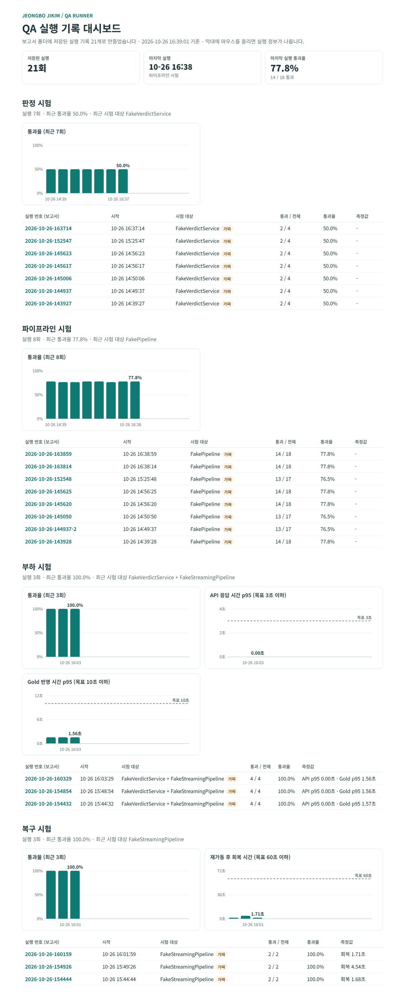

# 보고서·대시보드와 자동 검사

[← QA 안내로 돌아가기](../README.md)

## 보고서와 대시보드

실행할 때마다 보고서 폴더(기본 `reports/`)에 실행 번호로 파일이 생깁니다. 실행 번호는 시작 시각입니다(예: `2026-10-29-143015`). 같은 초에 다시 실행하면 `-2`, `-3`이 붙어 덮어쓰지 않습니다. 팀 공유 실행은 여러 PC에서 겹치지 않도록 UUID를 씁니다. 이 폴더는 Git에 올라가지 않습니다.

| 파일 | 용도 |
|---|---|
| `<실행 번호>.html` | 브라우저로 여는 보고서. 전체·통과·실패·통과율과 확인 항목별 결과 |
| `<실행 번호>.json` | 같은 내용을 대시보드·CI·데스크탑 앱이 읽는 용도 |
| `dashboard.html` | 폴더에 쌓인 모든 실행 기록을 모은 대시보드. 실행할 때마다 다시 만듦 |
| `team-runs/<UUID>.json` | 팀 공유 실행의 스냅샷 (재현·재전송용) |

보고서 표는 `케이스 · 확인 항목 · 입력 · 정답 · 실제 · 결과`로 되어 있고, 실패한 항목이 위에 먼저 나옵니다. 값을 못 받은 항목은 실제 값이 "시스템 실패"로 나오고 이유(연결 실패, 시간 초과 등)가 붙습니다. 가짜 시험 대상으로 실행한 보고서에는 "실제 시스템의 성능이 아닙니다"라는 안내가 붙습니다.

### 실행 기록 대시보드

`reports/dashboard.html`을 브라우저로 열면 지금까지 돌린 시험의 추이를 볼 수 있습니다. 데스크탑 앱의 **전체 추이** 버튼으로도 열립니다. CI 기록은 [웹 대시보드](https://seoloo.github.io/MLO2_3rd_Project/)에서 봅니다.

| 구역 | 내용 |
|---|---|
| 맨 위 | 저장된 실행 수, 마지막 실행 시각, 마지막 실행 통과율 |
| 시험 종류별 | 통과율 추이 막대 (최근 20회) |
| 부하 시험 | API 응답 시간 p95, Gold 반영 시간 p95 추이와 목표 점선 |
| 복구 시험 | 재가동 후 회복 시간 추이와 목표 점선 |
| 시험 종류별 표 | 최근 10회 실행 (실행 번호를 누르면 그 HTML 보고서로 이동, 가짜 대상이면 "가짜" 표시) |

- 저장된 JSON 보고서만 읽습니다. 보고서를 지우면 대시보드에서도 빠집니다.
- 막대에 마우스를 올리면 그 실행의 시각·값·시험 대상이 나옵니다.
- 결과 형태를 통일하기 전에 만든 옛 보고서는 건너뜁니다.
- 위 그림은 주제 전환 전 연습용 대상으로 돌린 기록입니다. 낮은 통과율은 연습용 대상의 틀린 규칙을 채점기가 잡아낸 결과이고, 부하·복구 수치는 실제 성능이 아닙니다. 판정 시험 기록부터는 탐지율·오탐률 항목이 함께 쌓입니다.

## 자동 검사 (GitHub Actions)

`qa/` 폴더나 `.github/workflows/qa.yml`이 바뀐 커밋을 `main`, `qa`, `feature/**` 브랜치에 푸시하거나 `main`으로 PR을 열면 GitHub가 자동으로 검사합니다.

| 순서 | 하는 일 | 실패로 보는 경우 |
|---|---|---|
| 1 | `qa-history` 브랜치에서 지난 실행 기록 가져오기 (없으면 건너뜀) | — |
| 2 | .NET 10 설치 후 빌드 (Windows 환경, 데스크탑 앱 포함) | 빌드 오류 |
| 3 | `dotnet test` | 테스트가 하나라도 실패 |
| 3-1 | QA 도구 점검(`--suite selfcheck`) | 점검이 하나라도 실패 (종료 코드 0이 아님) |
| 4 | 판정·파이프라인 시험, 부하 시험(10초 축소판), 복구 시험(20초 축소판) 실행 | 채점을 시작하지 못함 (종료 코드 2) |
| 5 | **기본 브랜치일 때만:** 실행 기록을 `qa-history` 브랜치에 저장 | 푸시 실패 |
| 6 | 보고서를 결과물(Artifacts `qa-reports`)로 첨부 | — |
| 7 | **기본 브랜치일 때만:** 대시보드를 GitHub Pages에 공개 | Pages 설정이 안 되어 있음 |

- 결과는 저장소의 **Actions** 탭이나 커밋 옆 ✔·✘에서 봅니다. **Run workflow** 버튼으로 직접 돌릴 수도 있습니다.
- `qa-history` 브랜치는 CI가 실행 기록만 쌓아 두는 별도 브랜치입니다. 사람이 직접 고치지 않습니다.
- 웹 대시보드를 공개하려면 처음 한 번 **Settings → Pages → Source**를 **GitHub Actions**로 바꿔야 합니다.
- 보고서·대시보드 시각은 한국 시간입니다.
- 지금은 연습용 대상이라 서비스 영역 시험 실패(종료 코드 1)가 정상이므로 검사 실패로 치지 않습니다. 반면 QA 도구 점검은 답을 이미 아는 입력이라 항상 통과해야 하므로 실패하면 바로 검사 실패입니다. 실제 백엔드·파이프라인을 연결하면 `qa.yml`에서 종료 코드 1도 실패로 바꿉니다.
- 공개 저장소라서 GitHub Actions 사용 시간은 차감되지 않습니다.
